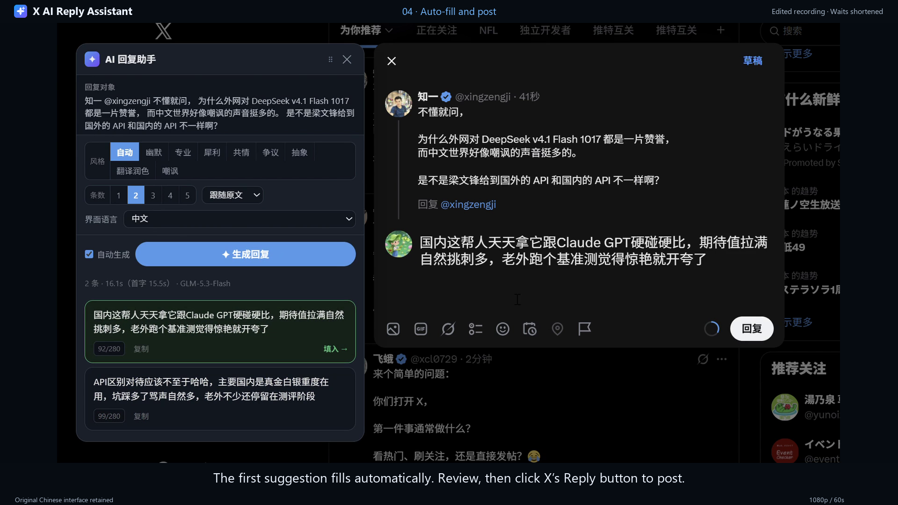
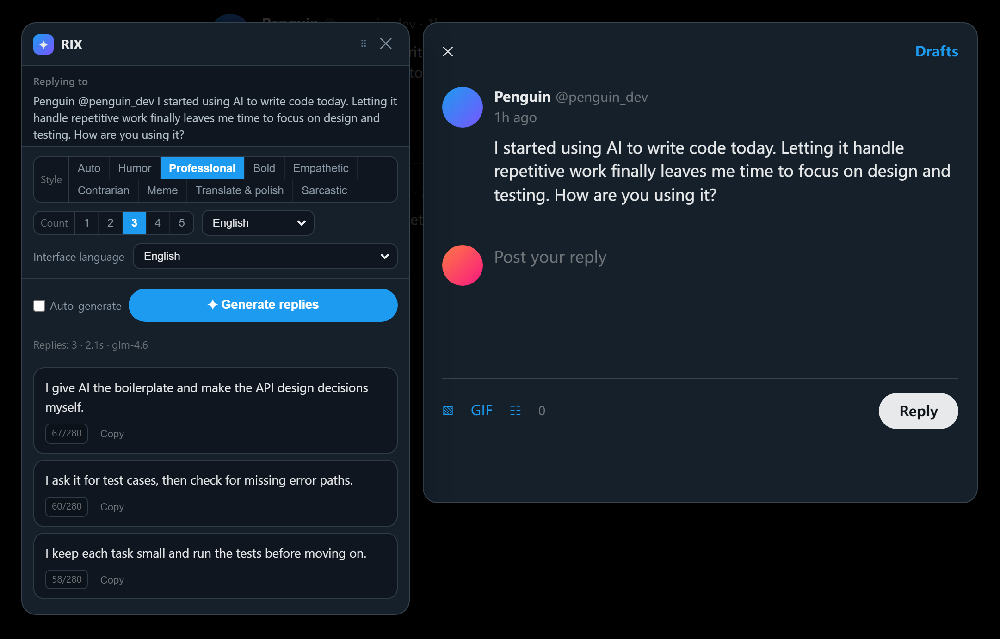
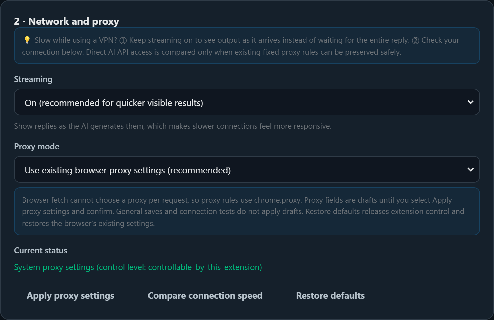
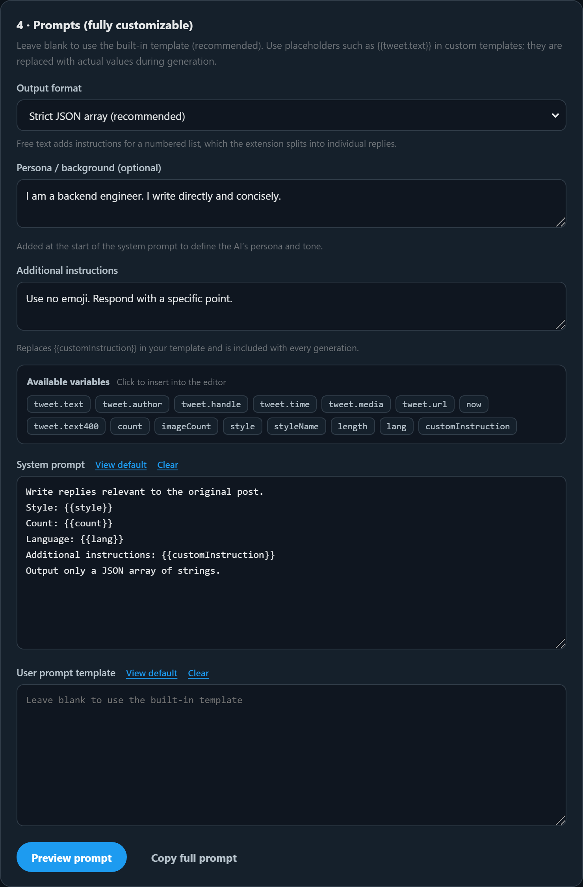

# SmartReply for X

[](LICENSE)
[](https://chromewebstore.google.com)

[中文](README.md) | [English](README.en.md) | [日本語](README.ja.md) | [Tiếng Việt](README.vi.md) | [한국어](README.ko.md)

Click **Reply** on a post in your X (Twitter) timeline to open the reply dialog. The extension reads the original post, asks your chosen AI model for **several reply suggestions**, and lets you insert a suggestion with one click.

This is a client-side Chrome extension built with Manifest V3. No separate application server is required. Your API key is stored locally in `chrome.storage.local`, and your browser sends requests directly to the model provider you select.

## ▶ Demo video

[](https://youtu.be/Rwp-c2AgEto)

**[▶ Watch the English demo on YouTube (60s · 1080p)](https://youtu.be/Rwp-c2AgEto)**

A real X workflow with English narration and subtitles. Click the preview to watch; the recorded interface remains in Chinese.

Video languages: [中文](https://youtu.be/dpnf_gy5-6I) | [English](https://youtu.be/Rwp-c2AgEto) | [日本語](https://youtu.be/YlWo3uloYP8) | [Tiếng Việt](https://youtu.be/kYoX6VaA7LA) | [한국어](https://youtu.be/Q62Dzl1gD8s) · [Video files and subtitles](store/real-demos/README.md)

### Interface preview



The screenshots below use this README's interface language, with sample data for demonstration only. The interface can still be switched between all five languages listed below.

---

## Features

| Feature | Description |
|---|---|
| Reply-dialog detection | Detects X reply dialogs using several selectors and fallback strategies |
| Post context | Reads the author, handle, text, publication time, and media types; also recognizes media-only posts |
| Multiple suggestions | Generates 1–5 suggestions with different approaches, rather than simple rewrites of one sentence |
| **Custom prompts** | **Editable system and user templates, 15 `{{variables}}`, and a live preview** |
| **Streaming** | **Shows each complete suggestion as it arrives; actual speed depends on the model and network** |
| **Draggable panel** | Drag the title bar to pin the panel; double-click to reset its position |
| Auto + 8 styles | Let the model choose a tone, or select Humor / Professional / Bold / Empathetic / Contrarian / Meme / Translate & polish / Sarcastic |
| One-click insertion | Inserts a suggestion into the Draft.js editor and dispatches the events needed for character counts and posting controls |
| Progress feedback | Shows elapsed time and first-response latency; displays a progress indicator after 30 seconds; supports stopping generation |
| Retry after failure | Restores an actionable Retry button after an error |
| Placement beside the dialog | Prefers the space to the left so the reply editor and posting controls remain accessible |
| Model providers | Zhipu GLM / DeepSeek / OpenAI / Claude / Kimi / OpenRouter / custom endpoints, including Ollama and vLLM |
| Multilingual interface | 中文 / English / 日本語 / Tiếng Việt / 한국어; follow the browser language or select one manually |

### Interface language and reply language

Choose **Interface language** in the reply panel, toolbar popup, or All settings. The default follows your browser. You can also select Chinese, English, Japanese, Vietnamese, or Korean manually. Changes apply immediately and are saved locally.

**Reply language** independently controls the language of AI-generated replies. It supports the same five languages and **Match original**. Changing the interface language does not change the reply language, existing suggestions, your draft, or custom prompt text.

### Shortcuts

- `Ctrl / ⌘ + Enter` — generate replies.
- `Esc` — close the panel.
- Use **Copy** on a suggestion card to copy that reply.

---

## Slow requests or VPN connections

Start with step 1; it is often sufficient.

### 1. Keep streaming enabled

Streaming is enabled by default. Without it, results appear only after the model finishes **all N replies**. With streaming, complete suggestions can appear and be used while the remaining suggestions are still being generated.

Waiting time depends on the model and network. The status bar shows first-response latency to help you assess the delay.

### 2. Compare network paths before changing proxy settings

In **2 · Network and proxy**, select **Compare connection speed**. It checks:

| Check | Meaning |
|---|---|
| Current network settings | Uses the browser's existing network configuration, including its active proxy or VPN path |
| Direct AI API connection | Attempts to reach the AI endpoint while bypassing the proxy |

Lower latency is faster. When a safe comparison is possible, the check preserves the existing fixed proxy server and routes for other websites, temporarily adds an AI-endpoint bypass, then restores the previous configuration.

The direct comparison runs only when the current fixed proxy rules can be preserved safely. With system proxies, PAC, or proxy settings controlled by another extension, only the current route is tested and the reason for skipping the direct comparison is shown.



### 3. Choose a proxy mode

| Mode | Scope | Behavior |
|---|---|---|
| **Follow system settings** | Does not take over browser proxy settings | Default; usually appropriate when your existing VPN or proxy already works |
| **Direct AI requests, proxy other traffic** | Entire browser | Uses the fixed proxy you supply, bypassing it for AI domains; asks for confirmation before replacing existing routing rules |
| **Direct connection globally** | ⚠️ Entire browser | Disables proxy routing for **all tabs**; some websites may become inaccessible; requires confirmation |

> Browser `fetch()` cannot assign a proxy to an individual request. Proxy configuration therefore uses the browser-wide `chrome.proxy` API. The fixed-proxy mode uses `bypassList` to bypass AI domains while sending other traffic through your specified proxy.
>
> The default `auto` mode does not take over browser proxy settings and releases this extension's earlier override. Both `direct` and `custom` show a confirmation explaining the scope.
> Changes in the proxy form remain drafts until you select **Apply proxy settings**. Normal autosave does not activate them.
> Restoring proxy defaults, resetting all settings, or disabling the extension in its settings clears this extension's proxy override and returns control to the browser.

---

## Panel controls

- **Move:** drag the title bar, the row containing `⠿`. The panel stays where you place it instead of following the dialog automatically.
- **Reset position:** double-click the title bar or select its Reset position button.
- Closing the reply dialog and opening a new one restores automatic placement beside the dialog.

---

## Installation

1. Open `chrome://extensions/`.
2. Enable **Developer mode** in the upper-right corner.
3. Select **Load unpacked** and choose the project root containing `manifest.json`.

The settings page opens automatically after the first installation.

### Configuration

1. Select the extension icon, then **All settings**.
2. Choose a provider under **Quick presets**, such as Zhipu GLM. The base URL and model name are filled in automatically.
3. Enter your **API key**.
4. Select **Test connection**. A sample response confirms that the configuration works.
5. Close settings and select Reply on a post in X.

> Avoid setting `max_tokens` too low. Reasoning models can use part of that budget for reasoning before producing reply text, which may leave the visible response empty even when the request succeeds. Values below 2000 can cause this problem; this project defaults to 4000. Requirements vary by model.

### Updating an installed extension

After changing the code or downloading an update, select **Reload** on the extension card in `chrome://extensions/`, then **refresh the X page**. Otherwise, open pages may continue running the old scripts.

---

## Prompt configuration

In **4 · Prompts**, three layers are configurable. **Leave a field empty to use the built-in default**, which is the recommended starting point.

| Layer | Purpose |
|---|---|
| **Persona / background** | Added at the beginning of the system prompt to define identity and tone |
| **Additional instructions** | Replaces `{{customInstruction}}` and is included in every generation |
| **System / user templates** | Replaces the built-in template; use `{{variables}}` as placeholders |

### Available variables: 15

Select a variable chip in settings to insert it at the cursor. Unknown variable names are flagged as you type.

| Variable | Meaning | Variable | Meaning |
|---|---|---|---|
| `tweet.text` | Original post text | `count` | Number of replies |
| `tweet.author` | Author's display name | `style` | Detailed style instructions |
| `tweet.handle` | Author's handle | `styleName` | Style name, such as Humor |
| `tweet.time` | Publication time | `length` | Reply-length instructions |
| `tweet.media` | Media types | `lang` | Reply language |
| `tweet.url` | Post URL | `customInstruction` | Additional instructions |
| `tweet.text400` | First 400 characters, used by Auto style | `now` | Current time when generating |
| `imageCount` | Number of images sent to the model | | |

### Output format

- **Strict JSON array:** the default and most reliable option. The extension uses balanced-bracket scanning and fallback parsing.
- **Free text:** asks the model for numbered entries such as `1. 2. 3.`; useful for custom styles.

### Example: concrete information without emotional language

```text
System:
You are an experienced engineer in a technical community. Be professional,
restrained, and informative.
Style: {{style}}
Number of replies: {{count}}
Language: {{lang}}
Do not use emoji or exclamation marks.

User:
Here is a post:
{{tweet.text}}

Write {{count}} replies. Each reply must contain a specific point or fact.
```

This example also works with **Output format = Free text**.

### Live preview

Select **Preview prompt** to render the complete prompts using a sample post. System and user messages are displayed separately. **No model request is made, so the preview does not use API credits.**

Preview a changed template before saving to inspect what will be sent to the model.

> Preview and generation share the same implementation in `src/shared/prompt.js`.



---

## Project structure

```text
manifest.json                 Extension manifest
src/
  shared/
    config.js                 Defaults, provider presets, Auto + 8 styles, variables
    i18n.js                   Five-language UI catalogs and runtime language switching
    utils.js                  Response parsing, language detection, character counts, toast
    prompt.js                 Prompt construction and interpolation for preview/generation
    proxy.js                  Proxy configuration and application in the service worker
  content/
    detector.js               Reply-dialog detection and post extraction
    editor.js                 Draft.js editor reading and insertion
    panel.js                  Suggestion panel, dragging, and streaming UI
    main.js                   Native Reply events and dialog polling
  background/
    service-worker.js         AI requests, SSE parsing, and two API protocols
  options/                    Settings and prompt editor
  popup/                      Toolbar popup and quick controls
icons/                        Extension icons
tools/                        Tests, static checks, and preview scripts
dev/                          UI preview screenshots
```

---

## Implementation notes

### Why model requests run in the service worker

Content-script requests are subject to page-origin and CSP restrictions. Sending model requests from the background service worker provides:

- Independence from X's page CSP for model requests.
- Isolation of the API key from page JavaScript; content scripts run in an isolated world.
- Central timeout and cancellation handling through `AbortController`.

### Inserting text into the editor

X's editor uses **React-controlled contenteditable / Draft.js**. Changing `el.innerHTML` or `el.textContent` alone can make text appear without updating the character count or posting controls because React does not know that its state changed.

The insertion sequence in `src/content/editor.js` is:

1. Focus the editor.
2. Select its contents using `Range` and clear them with `execCommand('delete')`, using the browser's editing path.
3. Attempt a native setter write, with an escaped DOM-write fallback when necessary.
4. Dispatch `input` with `inputType: 'insertText'`, followed by `change`.
5. Read the text back and retry the write if the check detects a mismatch.

### Four parsing fallbacks

Models do not always return a bare JSON array. `utils.parseReplyList` tries:

1. Parsing the complete response as JSON.
2. Extracting balanced arrays with awareness of escaped strings.
3. Finding a ` ```json ` code block.
4. Splitting plain text on line breaks or list markers such as `1.` and `-`.

> Taking everything from the first `[` to the last `]` is unsafe: references such as `[1]` may occur elsewhere in the response. Numeric arrays such as `[1,2,3]` are also rejected; replies must be strings.

### Streaming

The content script and service worker communicate over a **Port connection** using `chrome.runtime.connect`:

- SSE parsing supports LF, CRLF, and CR line endings, incomplete chunks, and UTF-8 characters split across chunks.
- `reasoning_content` and `thinking_delta` are tracked separately from reply text.
- The panel uses `parseCompleteReplyList`: **complete JSON-string suggestions can be selected immediately**. Incomplete suggestions are not clickable; placeholders indicate that more replies are coming.
- Closing the panel or stopping generation disconnects the stream and cancels the worker's request.

---

## Development and tests

```bash
# Core parsing, language detection, lengths, escaping, prompts, proxy, module contracts
node tools/test-core.js

# Background, settings, and content regressions with mocked network/Chrome APIs
node tools/test-config-regressions.js
node tools/test-network-regressions.js
node tools/test-settings-regressions.js
node tools/test-content-regressions.js
node tools/test-i18n.js
node tools/test-output-languages.js

# Chromium end-to-end tests, including real extension loading
python tools/test-e2e.py

# Fresh profiles: cross-page saves, confirmation cancellation, reset, streaming
# All external HTTP requests are intercepted; no real model is called
python tools/test-extension-regressions.py

# Translation-added text and protection against inserting into the wrong reply
python tools/test-reply-target-regressions.py

# Five UI languages, cross-page synchronization, independent reply language
python tools/test-i18n-browser.py

# Static checks for silent failures
node tools/check-comments.js
node tools/check-pages.js

# Render the panel and settings previews into dev/
python tools/preview.py
python tools/preview-options.py

# Generate README screenshots in all five languages
python tools/preview-readmes.py

# Regenerate icons; Python standard library only
python tools/make_icons.py
```

**Coverage:**

- **Unit tests:** parsing fallbacks, language detection, character counts, variable interpolation and validation, prompt formats and boundaries, SSE chunk/error handling, proxy modes, host extraction, and exported module contracts.
- **Browser tests:** dialog detection, reply-target extraction, editor insertion, Chinese/emoji/long text, replacement and clearing, suggestions, HTML escaping, media-only posts, real pointer dragging, viewport bounds, position reset, and popup/settings loading without script errors.

> Static checks catch failures that can still pass `node --check`: an unclosed block comment can swallow later code, and a page can omit a required shared script. A missing dependency inside an async initializer may otherwise leave the interface partially rendered with only an unhandled rejection in the console.

---

## FAQ

**The panel does not appear after selecting Reply.**

Check that the extension is enabled, refresh X after installation or an update, and enable Debug logging in settings to inspect the console.

**The console reports `Xxx is not a function`.**

Reload the extension in `chrome://extensions/`, then refresh X. An open page may still be running cached scripts.

**The reply dialog is open, but the panel still asks me to open it.**

Older versions compared the full text when a dialog had no post URL, so translation tools could cause a mismatch by appending text. The current version prefers the post ID. Without an ID, insertion can continue when the original element and its original text nodes are unchanged. Replaced text or a different target is still rejected. Reload the extension and refresh X after updating.

**The extension cannot find the reply dialog.**

X may have changed its DOM. Enable Debug logging, inspect the selectors, and update `D.SEL` in `src/content/detector.js` if needed. Several fallback selectors are already provided.

**Generation is slow.**

Keep streaming enabled so complete suggestions can appear sooner, and inspect first-response latency in the status bar. Use Compare connection speed to check network paths. A reasoning model may spend time thinking before returning visible text; use Disable deep thinking where the provider supports it, or select another model as appropriate.

**Must I configure a proxy in the extension?**

Usually not. The default uses the browser's existing network configuration. If you choose the fixed-proxy mode, AI domains bypass your proxy and other websites use the proxy you enter. This replaces existing PAC and routing rules and requires confirmation.

**Can the extension turn off my proxy?**

Not without your selection and confirmation. The default does not take over your proxy. Direct connection globally affects the whole browser. The fixed-proxy alternative also changes browser-wide rules. Disabling the extension in its settings, returning to the default mode, or resetting settings releases this extension's override.

**The panel overlaps the dialog, or I want it elsewhere.**

Drag the title bar containing `⠿` to pin it. Double-click the title bar or select Reset position to restore automatic placement.

**My custom prompt does not produce separate replies.**

Use Strict JSON array, remove contradictory instructions such as “output only one reply,” and preview the rendered prompts to verify that `{{count}}` is substituted correctly.

**What happens if I misspell a variable?**

Settings shows a warning. Unknown variables are replaced with empty strings during generation; literal placeholders such as `{{xxx}}` are not sent unchanged.

**Can I define my account's persona?**

Yes. Set Persona / background, for example: “I am a backend engineer. Be direct, avoid small talk, and do not use exclamation marks.” It is added at the start of every system prompt.

**Local Ollama requests fail.**

Use `http://localhost:11434/v1` as the base URL, select Test connection, and allow access to that address. Custom domains also require permission on the first connection; entering a URL alone does not grant access.

**Can I use another model?**

Yes, if it provides an OpenAI-compatible `/chat/completions` endpoint. Choose Custom (OpenAI compatible) and enter its base URL and model name.

## 📄 License

This project is released under the **PolyForm Noncommercial License 1.0.0** — free for personal use, learning, modification, and distribution. **Commercial use is not permitted** (no selling, paywalls, internal use by for-profit companies, or competing offerings).

See [LICENSE](LICENSE) for the full terms. For commercial licensing, contact [onlyonexhj](https://github.com/onlyonexhj).
