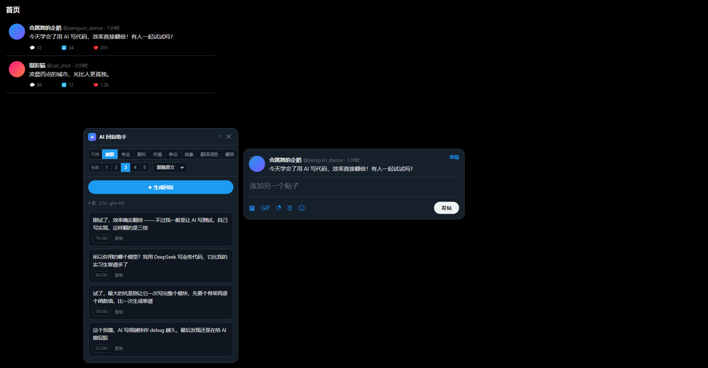
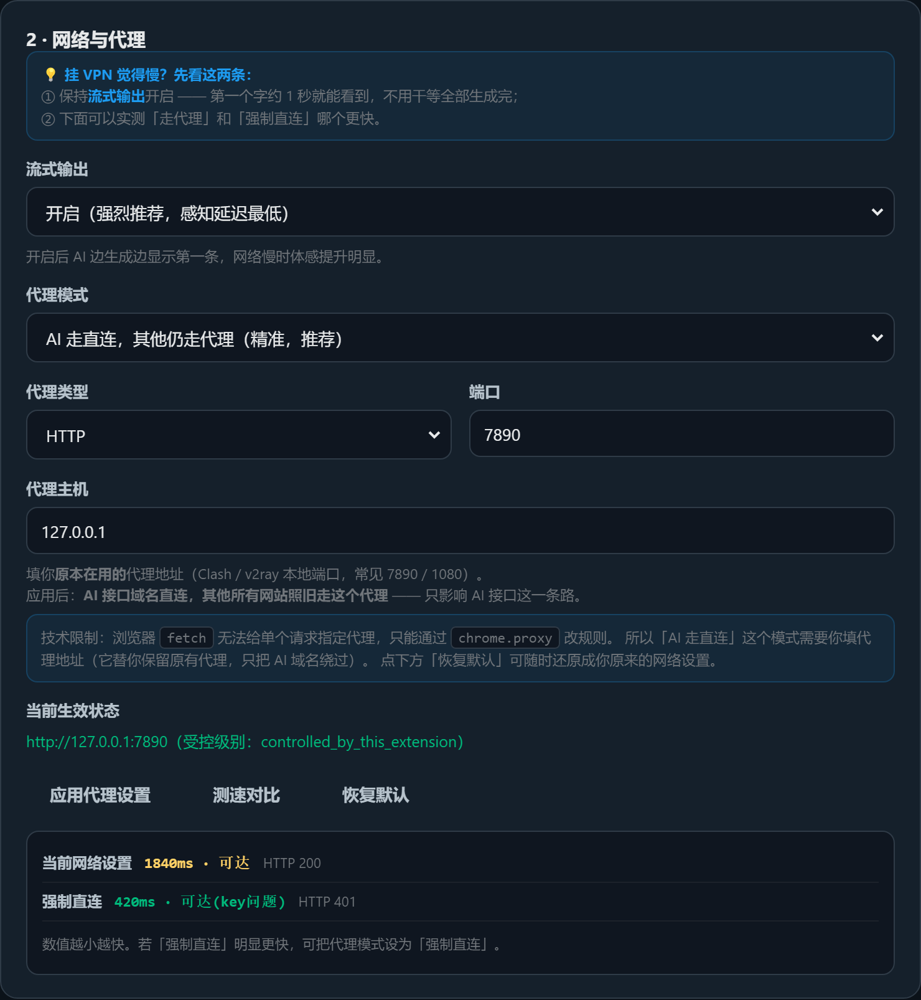
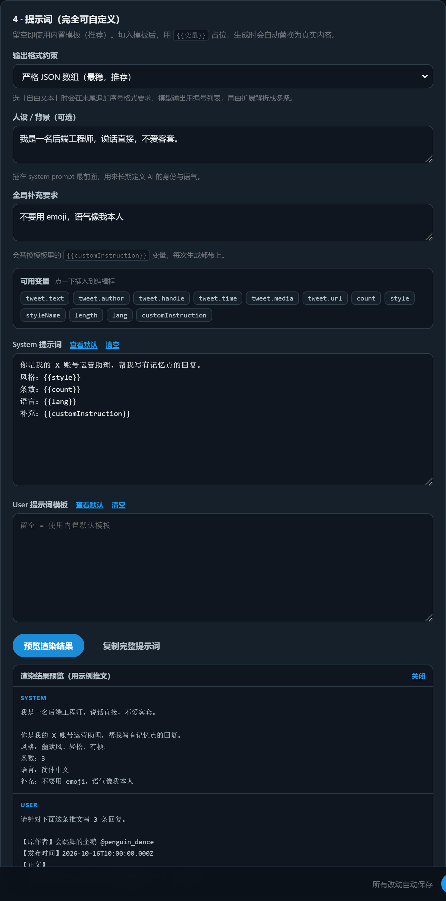

# X AI 返信アシスタント

[中文](README.md) | [English](README.en.md) | [日本語](README.ja.md) | [Tiếng Việt](README.vi.md) | [한국어](README.ko.md)

X（Twitter）のタイムラインで**返信ボタン**を押して投稿ダイアログを開くと、拡張機能が返信先のポストを自動で読み取り、AI で**複数の返信候補**を生成します。候補をクリックするだけで入力欄に挿入できます。

サーバー不要の Chrome 拡張機能（Manifest V3）です。API Key はローカルの `chrome.storage.local` にのみ保存され、リクエストはブラウザーから選択したモデルのサービス提供元へ直接送信されます。



スクリーンショットは表示例です。実際の画面は、以下の 5 言語に切り替えられます。

---

## 機能

| 機能 | 説明 |
|---|---|
| 返信ダイアログの自動検出 | X の返信用投稿ダイアログを検出します。複数のセレクターとフォールバックにより、X の画面変更にも対応しやすい構成です |
| ポストの内容を取得 | 投稿者、ハンドル、本文、投稿日時、メディアの種類を取得します。メディアのみのポストも認識できます |
| 複数の候補 | 1 回で 1～5 件を生成します。同じ文の言い換えではなく、それぞれ異なる切り口の返信を作成します |
| **プロンプトを設定可能** | **system / user テンプレートを自由に編集。15 個の `{{変数}}` を展開し、その場でプレビューできます** |
| **ストリーミング出力** | **候補が 1 件完成するごとに表示でき、すべての返信が完成するまで待つ必要はありません。実際の速度はモデルとネットワークによって異なります** |
| **パネルのドラッグ移動** | タイトルバーをドラッグすると、その位置に固定されます。ダブルクリックで元に戻せます |
| 自動 + 8 種類のスタイル | 口調を自動選択するか、ユーモア / 専門的 / 鋭い意見 / 共感 / 反対意見 / ミーム / 翻訳・推敲 / 皮肉を指定できます |
| ワンクリックで入力 | 候補をクリックすると Draft.js エディターに挿入され、**文字数カウントと投稿ボタンも正しく連動します** |
| 待ち時間を表示 | 生成中の経過時間と最初の応答までの時間を表示。30 秒を超えると進行状況バーが現れ、いつでも「中止」できます |
| エラー後に再試行 | エラー後はボタンが「↻ 再試行」に変わり、そのまま押せます。操作できない状態にはなりません |
| ダイアログを隠さない配置 | パネルをできるだけダイアログの左側に配置し、入力欄と投稿ボタンを見られるようにします |
| タイムラインのフローティングボタン | ポストにカーソルを合わせると「✦ AI 返信」が表示され、返信ボタンを押さずに生成できます |
| 複数のサービスに対応 | 智譜 GLM / DeepSeek / OpenAI / Claude / Kimi / OpenRouter / カスタム（Ollama、vLLM など） |
| 多言語の画面 | 中文 / English / 日本語 / Tiếng Việt / 한국어。ブラウザーの言語に合わせるか、手動で切り替えられます |

### 表示言語と返信の言語

返信パネル、拡張機能のポップアップ、設定ページで「表示言語」を選択できます。初期設定ではブラウザーの言語に従います。中国語、英語、日本語、ベトナム語、韓国語を手動で選ぶこともでき、変更はすぐに反映され、ローカルに保存されます。

「返信の言語」は、AI が生成する返信の言語を個別に指定します。上記の 5 言語と「原文に合わせる」に対応しています。表示言語を変更しても、返信の言語、生成済みの候補、編集中の文章、カスタムプロンプトは変わりません。

### キーボードショートカット

- `Ctrl / ⌘ + Enter` — 返信を生成
- `Esc` — パネルを閉じる
- 各候補カードの「コピー」ボタンを押すと、その候補をコピーできます

---

## 通信が遅い場合や、VPN を使うと遅くなる場合

手間と効果のバランスがよい順に説明します。**まずは 1 番を確認してください。** 多くの場合はこれで十分です。

### 1. 「ストリーミング出力」をオンにする（初期設定でオン）

ストリーミングを使わない場合、モデルが N 件を**すべて生成し終わるまで**結果を表示できません。ストリーミングでは、受信が完了した候補から順に表示し、すぐに使えます。残りの候補は後から追加されます。
実際の待ち時間はモデルとネットワークによって異なります。ステータスバーに表示される最初の応答までの時間（x.x 秒）で、応答の遅延を確認できます。

### 2. 接続速度を比較してから、プロキシを変更するか判断する

設定ページの **2 · ネットワークとプロキシ** → **「接続速度を比較」** を押すと、次の経路を測定します。

| 測定項目 | 意味 |
|---|---|
| 現在のネットワーク設定 | ブラウザー / システムの既存設定を使う経路（VPN が有効なら、その経路） |
| AI API への直接接続 | プロキシを経由せず、AI API に直接接続する経路 |

数値が小さい方が速い経路です。測定では、既存のプロキシサーバーと他のサイトへのルーティングを維持したまま、AI API のバイパスルールを一時的に追加し、終了後に元へ戻します。

直接接続との比較を安全に行えるのは、現在のブラウザーが、設定を維持できる固定プロキシルールを使用している場合に限られます。システムプロキシ、PAC、別の拡張機能が管理するプロキシの場合は、現在のネットワークだけを測定し、直接接続の比較をスキップした理由を表示します。



### 3. プロキシモードの選び方

| モード | 影響範囲 | 説明 |
|---|---|---|
| **システムの既定設定に従う** | 設定を変更しない | 初期設定です。システム側で VPN が有効なら、そのまま利用されます。**多くの方は変更不要です** |
| **AI は直接接続、他の通信はプロキシ経由** | ブラウザー全体 | 固定プロキシを指定します。AI ドメインはプロキシを回避し、他のサイトは指定したプロキシを使います。既存のルーティングルールを置き換える前に確認が表示されます |
| **すべて直接接続** | ⚠️ ブラウザー全体 | **すべてのタブ**でプロキシを無効にします。他のサイトに接続できなくなる場合があります。追加の確認が必要です |

> ⚠️ **この設計が必要な理由**：ブラウザーの `fetch()` には proxy オプションがなく、**リクエスト単位でプロキシを指定できません**。
> プロキシを指定するには、`chrome.proxy` で**ブラウザー全体**のルールを変更する必要があります。そのため「すべて直接接続」は、実際にブラウザー全体へ影響します。
> 「AI は直接接続、他の通信はプロキシ経由」モードは、このために用意しています。`bypassList` を使い、AI ドメインだけをプロキシの対象外にします。
>
> 既定の `auto` モードはブラウザーのプロキシを管理せず、この拡張機能が以前に適用した上書き設定を解除します。`direct` / `custom` では、影響範囲を明示した確認が表示されます。
> プロキシフォームの変更は「プロキシ設定を適用」を押して初めて保存されます。通常の自動保存では、未適用のプロキシ設定は有効になりません。
> 「既定に戻す」、すべての設定のリセット、設定ページでの拡張機能の無効化を行うと、この拡張機能によるプロキシの上書きを解除し、制御を戻します。

---

## パネルの操作

- **ドラッグ**：タイトルバー（`⠿` アイコンのある行）を押したまま移動します。ドラッグ後は**移動先の位置に固定**され、ダイアログを自動追従しなくなります。
- **位置を戻す**：タイトルバーをダブルクリックするか、右側の「位置を戻す」ボタンを押します。
- 投稿ダイアログを閉じて新しく開くと、パネルは再びダイアログの横へ自動配置されます。

---

## インストール

```
1. chrome://extensions/ を開く
2. 右上の「デベロッパー モード」をオンにする
3. 「パッケージ化されていない拡張機能を読み込む」を押し、このプロジェクトのルートディレクトリ（manifest.json がある階層）を選択する
```

初回インストール時には設定ページが自動で開きます。

### 設定

1. 拡張機能のアイコン →「すべての設定」を開きます。
2. 「クイック設定」でサービス提供元（智譜 GLM など）を選ぶと、Base URL とモデル名が自動入力されます。
3. **API Key** を入力します。
4. **「接続テスト」** を押し、サンプルが返ってくれば設定完了です。
5. 設定ページを閉じ、X で返信ボタンを押してください。

> ⚠️ **max_tokens を小さくしすぎないでください。** 推論モデル（GLM シリーズ / o シリーズ / Claude の思考対応版）は、本文を出力する前に reasoning tokens を消費します。
> 値が小さいと、**エラーが出ないまま**「リクエストは成功したのに本文が空」という状態になります。2000 未満では特に起こりやすいため、このプロジェクトの初期値は 4000 です。

### インストール済みの拡張機能を更新する

コードを変更した場合や、ダウンロードし直した場合は、`chrome://extensions/` で拡張機能のカードにある**再読み込みボタン**を押し、その後 **X のページを再読み込み**してください。
再読み込みを行わないと、ブラウザーはキャッシュされた古いスクリプトを使い続けます。

---

## プロンプトの設定

設定ページの **4 · プロンプト** で、次の 3 段階を設定できます。**空欄なら内蔵の既定値を使います**（推奨）。

| 設定項目 | 役割 |
|---|---|
| **人物像 / 背景** | system prompt の先頭に追加し、AI の人物像と口調を継続的に指定します |
| **共通の追加指示** | テンプレートの `{{customInstruction}}` を置き換え、生成のたびに適用されます |
| **System / User テンプレート** | プロンプト全体を自由に設定します。`{{変数}}` をプレースホルダーとして使えます |

### 使用できる変数（15 個）

設定ページで変数のタグをクリックすると、カーソル位置に挿入できます。変数名が間違っていると、その場で警告が表示されます。

| 変数 | 意味 | 変数 | 意味 |
|---|---|---|---|
| `tweet.text` | ポストの本文 | `count` | 生成する件数 |
| `tweet.author` | 投稿者の表示名 | `style` | スタイルの説明（詳細な指示を含む） |
| `tweet.handle` | 投稿者のハンドル | `styleName` | スタイル名（「ユーモア」など） |
| `tweet.time` | 投稿日時 | `length` | 長さの指定 |
| `tweet.media` | メディアの種類 | `lang` | 出力言語 |
| `tweet.url` | ポストの URL | `customInstruction` | 追加指示 |
| `tweet.text400` | 本文の先頭 400 文字（自動スタイルで使用） | `now` | 生成時の現在時刻 |
| `imageCount` | モデルに送信する画像の枚数 | | |

### 出力形式

- **厳密な JSON 配列**（既定・推奨）— 括弧の対応関係を走査して解析し、複数のフォールバックも用意しています。
- **自由形式のテキスト** — モデルに `1. 2. 3.` の番号付きで出力させます。カスタムスタイルで、より自由に使えます。

### 例：感情表現を抑え、具体的な内容に絞る

```text
System:
あなたは技術コミュニティの経験豊富なエンジニアです。返信は専門的で、落ち着いた、情報のある内容にしてください。
スタイル：{{style}}
件数：{{count}}
言語：{{lang}}
絵文字や感嘆符は使わないでください。

User:
以下は 1 件のポストです。
{{tweet.text}}

返信を {{count}} 件作成してください。それぞれに具体的な意見または事実を含めてください。
```

「出力形式 = 自由形式のテキスト」と組み合わせると、より適しています。

### リアルタイムプレビュー

「プロンプトをプレビュー」を押すと、**サンプルのポストを使ってプロンプト全体を展開**します（system と user を分けて表示）。**API の利用枠は消費しません**。
テンプレートを変更したら、保存前にプレビューすることで、モデルに送信される内容を確認できます。

> プレビューと実際の送信は、どちらも `src/shared/prompt.js` の同じ処理を使っています。



---

## ディレクトリ構成

```text
manifest.json                 拡張機能のマニフェスト
src/
  shared/
    config.js                 初期設定、サービスのプリセット、自動 + 8 種類のスタイル、テンプレート変数一覧
    i18n.js                   5 言語の UI 辞書、ブラウザー言語の判定、即時の言語切り替え
    utils.js                  モデル出力の解析、言語判定、文字数カウント、トースト通知
    prompt.js                 ★ プロンプトテンプレートの構築と変数展開（プレビューと送信で共用）
    proxy.js                  ★ プロキシモードの構築と適用（service worker 専用）
  content/
    detector.js               ★ ダイアログの検出とポスト内容の取得
    editor.js                 ★ Draft.js エディターの読み書き（候補の入力処理）
    panel.js                  AI 候補パネルの UI（ドラッグ移動とストリーミング表示）
    main.js                   エントリーポイント：イベント登録、ダイアログのポーリング、フローティングボタン
    content.css               タイムラインのフローティングボタンのスタイル
  background/
    service-worker.js         AI リクエストの中継、SSE ストリーミング解析、2 種類のプロトコル対応
  options/                    設定ページ（プロンプトエディターを含む）
  popup/                      ツールバーポップアップ（簡易切り替え）
icons/                        拡張機能のアイコン
tools/                        テスト、静的チェック、プレビュー用スクリプト
dev/                          UI プレビュー画像
```

---

## 主な実装について

### AI 呼び出しを service worker で行う理由

content script の `fetch` はページの CSP と同一オリジンポリシーの制約を受けるため、モデルのサービス提供元へ直接接続できません。background で実行すると、次のようになります。

- X のページの CSP に制限されません。
- API Key がページの JS に公開されません（content script とページの実行環境は分離されています）。
- タイムアウトと中止（`AbortController`）をまとめて管理できます。

### エディターへの入力にこの方法を使う理由

X の投稿欄は **React が制御する contenteditable（Draft.js）** です。単に `el.innerHTML = x` や `el.textContent = x` とすると、次のような分かりにくい状態になります。

> **文字は表示されるのに、文字数が変わらず、投稿ボタンも無効のままになる。**

React の state が内容の変更を認識していないためです。正しい処理は次のとおりです（`src/content/editor.js` を参照）。

1. エディターに `focus()` します。
2. `Range` で全内容を選択し、`execCommand('delete')` で消去します（ブラウザー本来の編集処理を通すことで、Draft が変更を認識できます）。
3. ネイティブの setter による入力を試し、対応していなければ、エスケープ済みの DOM 書き込みにフォールバックします。
4. `input`（`inputType: 'insertText'`）と `change` イベントを発行し、Draft の state を更新します。
5. 入力後に内容を読み直して照合し、一致しなければ 1 回再試行します。

### モデル出力の解析に 4 段階のフォールバックを使う理由

実際のモデルが、常に厳密な JSON 配列だけを出力するとは限りません。`utils.parseReplyList` は次の順に試します。

1. 出力全体を JSON 配列として解析します。
2. **括弧の対応関係を走査**し（文字列のエスケープも考慮）、長いテキストから配列を取り出します。
3. ` ```json ` コードブロックを探します。
4. 最後の手段として、改行や `1.` `-` で始まる番号付き・箇条書きリストに分割します。

> 「最初の `[` から最後の `]` まで」を抜き出すだけでは、本文に「文献 [1] によると」のような表現が含まれた際に誤って切り出してしまいます。
> また、`[1,2,3]` のような**数値の配列**は対象外です。**文字列の配列**のみを受け入れます。

### ストリーミング出力の仕組み

content script と service worker は、sendMessage ではなく **Port による持続接続**（`chrome.runtime.connect`）を使います。

- SSE は LF、CRLF、CR の改行に対応します。チャンクをまたいでバッファーを保持し、分割された UTF-8 文字も処理します。
- `reasoning_content` / `thinking_delta` は個別に集計し、返信本文には混ぜません。
- パネルは `parseCompleteReplyList` を使い、**受信が完了した JSON 文字列の候補から選択・入力できます**。途中までの返信はクリックできず、未完了の候補にはプレースホルダーを表示します。
- パネルを閉じる、または中止を押すと、能動的に `disconnect` します。service worker 側で直ちに `abort` し、不要なトークン消費を抑えます。

---

## 開発とテスト

```bash
# コアロジックの単体テスト（解析 / 言語 / 文字数 / XSS / プロンプト / プロキシ / モジュール契約）
node tools/test-core.js

# 実際のバックグラウンド、設定ページ、パネル処理の回帰テスト（ネットワークと Chrome API をモック化）
node tools/test-config-regressions.js
node tools/test-network-regressions.js
node tools/test-settings-regressions.js
node tools/test-content-regressions.js
node tools/test-i18n.js
node tools/test-output-languages.js

# E2E 検証（実際の Chromium に拡張機能を読み込み）
# 対象：DOM ロジック、パネルのドラッグ移動、popup/options ページのエラーなしの読み込み
python tools/test-e2e.py

# 新しいブラウザープロファイルで、ページ間の保存、確認のキャンセル、リセット、ストリーミングパネルを検証
# 外部 HTTP リクエストをすべてインターセプトし、実際のモデルは呼び出さない
python tools/test-extension-regressions.py

# 翻訳拡張機能が訳文を追加した後の返信先照合と、返信先を切り替えた際の誤入力防止
python tools/test-reply-target-regressions.py

# 実際のブラウザーで、5 言語の切り替え、ページ間の同期、返信言語の独立した設定を検証
python tools/test-i18n-browser.py

# 静的チェック（気づかれずに機能しなくなる不具合を防止。コミット前の実行を推奨）
node tools/check-comments.js   # コメントにコードが取り込まれる問題（node --check では検出不可）
node tools/check-pages.js      # 拡張機能ページでのスクリプト読み込み漏れ

# パネルの UI プレビュー画像を dev/ に出力
python tools/preview.py

# 設定ページ（プロンプトエディターを含む）のプレビュー画像を dev/ に出力
python tools/preview-options.py

# アイコンを再生成（標準ライブラリのみ。PIL は不要）
python tools/make_icons.py
```

**テストの対象範囲**：

- **単体テスト**：`parseReplyList` の 4 段階のフォールバック、言語判定、文字数カウント、テンプレート変数の展開（中国語の変数名を含む）、変数名の検証、`buildPrompt` の各種条件（既定 / カスタム / 人物像 / plain / 境界値）、SSE 解析（分割データ / 不正な行 / `[DONE]` / keepalive / reasoning の分離）、プロキシ設定、`extractHost` の境界値、**モジュールの完全性契約**（各モジュールが公開する関数の存在を明示的に検証）。
- **E2E**：ダイアログの検出、返信モードの判定、ポスト本文 / 投稿者 / 日時の取得、エディターへの入力（中国語 + 絵文字 + 長文 + 上書き）、消去、複数候補の解析、XSS エスケープ、メディアのみのポスト、パネルのドラッグ移動（実際のマウス操作：移動量 / 画面内への配置 / 位置固定 / ダブルクリックでのリセット）、popup と options ページをエラーなしで読み込めること。

> **静的チェックが必要な理由**：構文は正しく、`node --check` が成功しても、実行時に動作しなくなる不具合が 2 種類あります。
> ① ブロックコメントの `*/` の書き忘れで、後続のコードがコメントに取り込まれる。② 拡張機能のページで shared スクリプトの読み込みが抜ける。
> 後者が `async` 関数内で起きると、`Uncaught (in promise)` になり、しかも**画面は一見正常に見えます**。
> この 2 つのツールは、こうした問題を検出するためのものです。

---

## よくある質問

**Q：返信ボタンを押してもパネルが表示されません。**
A：① 拡張機能のアイコンがグレーになっていないか、ポップアップのスイッチがオンになっているか確認してください。② X のページを再読み込みしてください（拡張機能のインストールや更新後に一度必要です）。③ 設定で「デバッグログ」を有効にし、Console を確認してください。

**Q：Console に `Xxx is not a function` と表示されます。**
A：拡張機能を再読み込みしておらず、ブラウザーがキャッシュされた古いスクリプトを実行している可能性が高いです。`chrome://extensions/` で拡張機能のカードの再読み込みボタンを押し、X のページも再読み込みしてください。

**Q：返信ダイアログが開いているのに、「先にこのポストの返信ダイアログを開いてください」と表示されます。**
A：旧バージョンでは、ダイアログ内にポストのリンクがない場合に本文全体を再照合していたため、翻訳拡張機能が訳文を追加すると別のポストと誤判定する場合がありました。現在のバージョンは元のポスト ID を優先して取得します。ID がなくても、原文のノードと元のテキストが変わっていなければ入力を続けられます。原文が置き換えられた場合や返信先が変わった場合は、引き続き入力を防止します。コードを更新したら、まず拡張機能を再読み込みし、その後 X のページを再読み込みしてください。

**Q：「投稿ダイアログが見つかりません」と表示されます。**
A：X の画面変更により、セレクターが使えなくなった可能性があります。設定 →「デバッグログを有効にする」をオンにすると、Console に検出結果が表示されます。新しい `data-testid` を `src/content/detector.js` の `D.SEL` に追加すれば対応できます。セレクターは複数の候補とフォールバックを用意しているため、通常は変更不要です。

**Q：生成が遅いです。**
A：まず「ストリーミング出力」がオン（初期設定）か確認してください。受信が完了した候補から先に表示できます。ステータスバーには最初の応答までの時間（x.x 秒）が表示されます。それでも遅い場合は、設定ページの **「接続速度を比較」** でネットワーク経路を確認してください。推論モデルは本文の出力前に思考時間がかかる場合もあります。設定の「深い思考を無効にする」（サービス側の対応が必要）を使うか、必要に応じてモデルを変更できます。

**Q：プロキシを必ず設定する必要がありますか。**
A：多くの場合は不要です。初期設定では、ブラウザーが既に使っているネットワーク設定を使用します。調整が必要な場合は、固定プロキシを入力して **「AI は直接接続、他の通信はプロキシ経由」** を使えます。このモードは AI ドメインのみプロキシを回避し、その他のサイトには指定した固定プロキシを使います。既存の PAC とルーティングルールを置き換えるため、適用前に確認が表示されます。

**Q：拡張機能がプロキシを無効にすることはありますか。**
A：**無断で無効にはしません。** 既定の「システムの既定設定に従う」モードでは、拡張機能はプロキシ設定を管理しません。手動で「すべて直接接続」を選んだ場合のみ（確認が表示されます）、ブラウザー全体のプロキシを無効にします。そのため、このモードは推奨していません。接続先ごとに制御したい場合は「AI は直接接続、他の通信はプロキシ経由」を使ってください。
なお、設定ページで拡張機能を無効にする、既定に戻す、すべての設定をリセットする場合は、この拡張機能によるプロキシの上書きを解除し、ブラウザーの元の設定に戻します。

**Q：パネルがダイアログに重なります。別の位置に置けますか。**
A：タイトルバー（`⠿` のある行）を押したまま好きな位置へドラッグしてください。移動後はその位置に固定され、自動追従しなくなります。タイトルバーのダブルクリック、または「位置を戻す」で自動配置に戻せます。

**Q：候補をクリックすると「投稿ダイアログが開いていません」と表示されます。**
A：タイムラインのフローティングボタンから生成した場合は、まだダイアログが開いていません。先にそのポストの返信ボタンを押してダイアログを開き、その後に候補をクリックしてください。通常、返信ボタンから開いた場合には発生しません。

**Q：カスタムテンプレートを使うと AI が指示に従わない、または複数の返信を解析できません。**
A：①「出力形式 = 厳密な JSON 配列」を維持してください。② テンプレートに「1 件だけ出力する」などの矛盾する指示がないか確認してください。③「プロンプトをプレビュー」で、`{{count}}` が希望する件数に置き換わっているか確認してください。

**Q：変数名を間違えるとどうなりますか。**
A：設定ページに赤字の警告がすぐに表示されます。生成時、未定義の変数は**空文字列**に置き換わるため、`{{xxx}}` がそのままモデルに送信されることはありません。

**Q：自分のアカウントの人物像を設定できますか。**
A：できます。「人物像 / 背景」に、たとえば「私はバックエンドエンジニアです。率直に話し、社交辞令や感嘆符は使いません」と入力してください。毎回の system prompt の先頭に追加されます。

**Q：ローカルの Ollama でエラーになります。**
A：Base URL を `http://localhost:11434/v1` に設定し、設定ページで「接続テスト」を押して、そのアドレスへのアクセスを許可してください。カスタムドメインへ初めて接続する場合も許可が必要です。アドレスを入力するだけではアクセス権は付与されません。

**Q：別のモデルに変更できますか。**
A：OpenAI の `/chat/completions` と互換性があれば使えます。設定ページの「カスタム（OpenAI 互換）」で Base URL とモデル名を入力してください。
