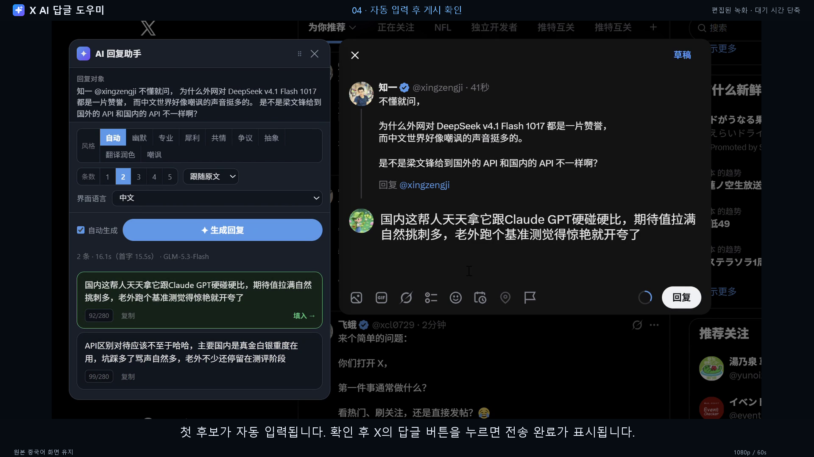
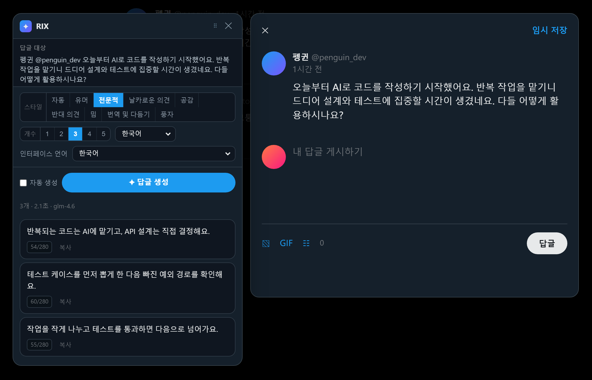
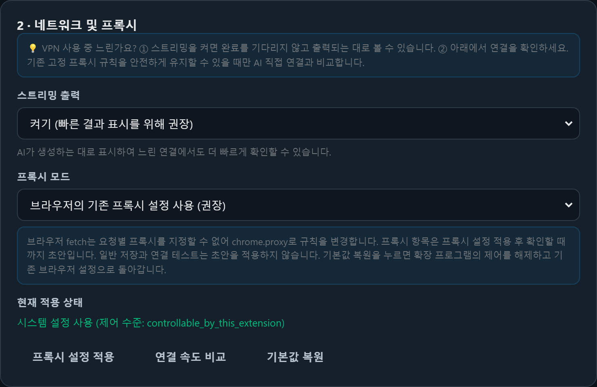
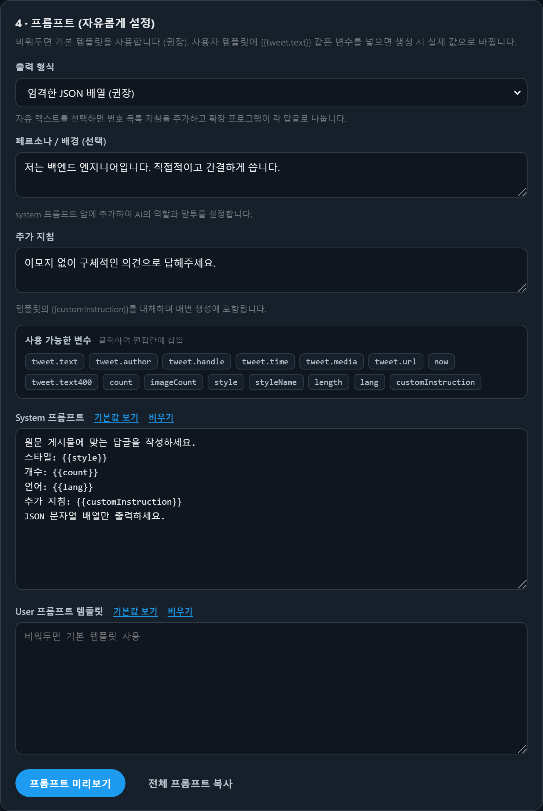

# RIX

[中文](README.md) | [English](README.en.md) | [日本語](README.ja.md) | [Tiếng Việt](README.vi.md) | [한국어](README.ko.md)

X(Twitter) 타임라인에서 **답글 아이콘**을 눌러 작성 대화상자를 열면, 확장 프로그램이 답글을 달 원래 게시물의 내용을 자동으로 읽고 AI로 **여러 개의** 답글 후보를 생성합니다. 원하는 후보를 누르면 입력란에 바로 입력됩니다.

서버가 필요 없는 순수 프런트엔드 Chrome 확장 프로그램(Manifest V3)입니다. API Key는 로컬 `chrome.storage.local`에만 저장되며, 요청은 브라우저에서 선택한 모델 제공업체로 직접 전송됩니다.

## ▶ 데모 영상

[](https://youtu.be/Q62Dzl1gD8s)

**[▶ YouTube에서 한국어 데모 보기(60초 · 1080p)](https://youtu.be/Q62Dzl1gD8s)**

실제 X 사용 과정을 한국어 내레이션과 자막으로 소개합니다. 이미지를 클릭하면 영상을 볼 수 있습니다. 녹화된 인터페이스는 중국어입니다.

영상 언어: [中文](https://youtu.be/dpnf_gy5-6I) | [English](https://youtu.be/Rwp-c2AgEto) | [日本語](https://youtu.be/YlWo3uloYP8) | [Tiếng Việt](https://youtu.be/kYoX6VaA7LA) | [한국어](https://youtu.be/Q62Dzl1gD8s) · [영상 파일 및 자막](store/real-demos/README.md)

### 인터페이스 미리보기



아래 스크린샷은 이 README와 같은 언어의 화면을 사용하며, 예시 데이터는 데모용입니다. 화면은 여전히 아래의 다섯 언어로 전환할 수 있습니다.

---

## 기능

| 기능 | 설명 |
|---|---|
| 답글 대화상자 자동 감지 | 여러 선택자와 대체 탐색 방식을 사용해 X의 답글 작성 대화상자를 감지하므로 화면 구조 변경에 비교적 잘 대응합니다 |
| 게시물 내용 추출 | 작성자, 핸들, 본문, 게시 시각, 미디어 유형을 추출하며, 미디어만 있는 게시물도 인식합니다 |
| 여러 답글 후보 | 한 번에 1~5개의 후보를 생성합니다. 같은 문장을 바꾸어 쓰는 대신 서로 다른 스타일로 작성합니다 |
| **프롬프트 설정** | **system / user 템플릿을 자유롭게 지정하고, 15개의 `{{변수}}`를 삽입하며 실시간으로 미리 볼 수 있습니다** |
| **스트리밍 출력** | **완성된 후보부터 표시되므로 모든 답글이 끝날 때까지 기다릴 필요가 없습니다. 실제 속도는 모델과 네트워크에 따라 달라집니다** |
| **패널 드래그** | 제목 표시줄을 잡아 이동하면 위치가 고정됩니다. 두 번 클릭하면 초기 위치로 돌아갑니다 |
| 자동 + 8가지 스타일 | 어조를 자동으로 선택하거나 유머 / 전문적 / 날카로운 의견 / 공감 / 반대 의견 / 밈 / 번역 및 다듬기 / 풍자 중에서 지정합니다 |
| 한 번의 클릭으로 입력 | 후보를 누르면 Draft.js 편집기에 입력되며, **글자 수와 게시 버튼도 정상적으로 갱신됩니다** |
| 긴 대기 시간 안내 | 생성 중 실시간 경과 시간과 첫 글자 지연 시간을 표시합니다. 30초를 넘으면 진행 표시줄이 나타나며, 언제든지 중지할 수 있습니다 |
| 실패 시 재시도 | 오류가 나면 버튼이 「↻ 다시 시도」로 바뀝니다. 버튼이 작동하지 않는 상태로 남지 않습니다 |
| 대화상자를 가리지 않는 배치 | 패널을 우선 대화상자 왼쪽에 배치하여 입력란과 게시 버튼을 계속 볼 수 있게 합니다 |
| 여러 제공업체 | Zhipu GLM / DeepSeek / OpenAI / Claude / Kimi / OpenRouter / 사용자 지정(Ollama, vLLM 등) |
| 다국어 화면 | 中文 / English / 日本語 / Tiếng Việt / 한국어를 지원하며, 브라우저 언어를 따르거나 직접 선택할 수 있습니다 |

### 인터페이스 언어와 답글 언어

답글 패널, 확장 프로그램 팝업, 전체 설정에서 「인터페이스 언어」를 선택할 수 있습니다. 기본값은 브라우저 언어를 따르며, 중국어·영어·일본어·베트남어·한국어 중에서 직접 선택할 수도 있습니다. 변경 사항은 즉시 적용되고 로컬에 저장됩니다.

「답글 언어」는 AI가 작성할 답글의 언어를 별도로 지정합니다. 위의 다섯 언어와 「원문에 맞춤」을 지원합니다. 인터페이스 언어를 바꾸어도 답글 언어, 생성된 후보, 편집 중인 글, 사용자 지정 프롬프트는 바뀌지 않습니다.

### 단축키

- `Ctrl / ⌘ + Enter` — 답글 생성
- `Esc` — 패널 닫기
- 후보 카드의 「복사」 버튼을 누르면 해당 답글이 복사됩니다

---

## 네트워크가 느리거나 VPN을 켜면 느려질 때

효과와 수고를 고려한 순서입니다. **먼저 1번부터 확인하세요.** 대부분의 경우 이것만으로도 충분합니다.

### 1. 「스트리밍 출력」을 켜 둡니다(기본값: 켜짐)

스트리밍을 사용하지 않으면 모델이 N개의 답글을 **모두 생성한 후에야** 결과가 표시됩니다. 스트리밍을 사용하면 완전히 수신된 후보부터 먼저 표시되고 사용할 수 있으며, 나머지 후보는 차례로 추가됩니다.
실제 대기 시간은 모델과 네트워크에 따라 달라집니다. 상태 표시줄의 「첫 글자 x.x s」로 응답 지연을 확인할 수 있습니다.

### 2. 속도를 비교한 다음 프록시 변경 여부를 결정합니다

설정 페이지의 **2 · 네트워크 및 프록시** → **「연결 속도 비교」**를 누르면 다음 두 경로를 측정합니다.

| 측정 항목 | 의미 |
|---|---|
| 현재 네트워크 설정 | 브라우저/시스템 기본 경로 사용(VPN이 적용되어 있다면 이 경로를 사용) |
| AI API 직접 연결 | 프록시를 우회해 AI API에 직접 연결 |

숫자가 작을수록 빠릅니다. 측정 중에도 기존 프록시 서버와 다른 사이트의 라우팅을 유지하며, AI API에 대한 우회 규칙만 임시로 추가했다가 끝나면 복원합니다.

브라우저가 기존 설정을 유지할 수 있는 고정 프록시 규칙을 사용 중일 때만 안전하게 직접 연결을 비교할 수 있습니다. 시스템 프록시, PAC, 다른 확장 프로그램이 제어하는 프록시는 현재 네트워크만 측정하고 직접 연결 비교를 건너뛴 이유를 명확히 표시합니다.



### 3. 프록시 모드 선택

| 모드 | 영향 범위 | 설명 |
|---|---|---|
| **시스템 기본값 따르기** | 설정을 변경하지 않음 | 기본값입니다. 시스템 수준에서 VPN이 작동 중이면 이미 해당 경로를 사용하므로 **대부분의 사용자는 변경할 필요가 없습니다** |
| **AI만 직접 연결, 나머지는 프록시 사용** | 브라우저 전체 | 고정 프록시를 입력하면 AI 도메인만 우회하고 나머지 사이트는 해당 프록시를 사용합니다. 적용 전에 기존 라우팅 규칙을 바꾸는지 확인을 요청합니다 |
| **전체 직접 연결** | ⚠️ 브라우저 전체 | **모든 탭**의 프록시가 꺼지므로 다른 사이트에 접속하지 못할 수 있습니다. 추가 확인이 필요합니다 |

> ⚠️ **이 방식이 필요한 이유**: 브라우저의 `fetch()`에는 proxy 옵션이 없으므로 **요청 하나에 별도 프록시를 지정할 수 없습니다**.
> 프록시를 지정하려면 `chrome.proxy`를 통해 **브라우저 전체** 규칙을 바꾸어야 합니다. 따라서 「전체 직접 연결」은 실제로 브라우저 전체에 영향을 줍니다.
> 「AI만 직접 연결, 나머지는 프록시 사용」 모드는 이를 위해 마련되어 있으며, `bypassList`로 AI 도메인만 정확히 우회합니다.
>
> 기본 `auto` 모드는 브라우저 프록시를 제어하지 않으며 이 확장 프로그램이 적용했던 프록시 재정의를 해제합니다. `direct` / `custom`은 모두 확인 창을 띄워 영향 범위를 안내합니다.
> 프록시 양식의 변경 사항은 「프록시 설정 적용」을 눌러야 저장됩니다. 일반 자동 저장으로는 프록시 초안이 적용되지 않습니다.
> 「기본값 복원」, 전체 설정 초기화, 설정에서 확장 프로그램 비활성화를 실행하면 이 확장 프로그램의 프록시 재정의를 지우고 제어권을 돌려줍니다.

---

## 패널 사용법

- **이동**: 제목 표시줄(`⠿` 아이콘이 있는 줄)을 잡아 드래그합니다. 이동 후에는 **놓은 위치에 고정**되며 대화상자를 자동으로 따라가지 않습니다.
- **위치 초기화**: 제목 표시줄을 두 번 클릭하거나 제목 표시줄 오른쪽의 「위치 초기화」 버튼을 누릅니다.
- 작성 대화상자를 닫았다가 새로 열면 패널이 다시 대화상자 옆에 자동으로 배치됩니다.

---

## 설치

```
1. chrome://extensions/를 엽니다.
2. 오른쪽 위의 「개발자 모드」를 켭니다.
3. 「압축해제된 확장 프로그램을 로드합니다」를 누르고 이 프로젝트의 루트 폴더(manifest.json이 있는 폴더)를 선택합니다.
```

처음 설치하면 설정 페이지가 자동으로 열립니다.

### 설정

1. 확장 프로그램 아이콘 → 「전체 설정」을 누릅니다.
2. 「빠른 설정」에서 제공업체(예: Zhipu GLM)를 선택하면 Base URL과 모델 이름이 자동으로 채워집니다.
3. **API Key**를 입력합니다.
4. **「연결 테스트」**를 누릅니다. 예시 응답이 돌아오면 설정이 올바른 것입니다.
5. 설정 페이지를 닫고 X에서 답글 아이콘을 누릅니다.

> ⚠️ **max_tokens를 너무 작게 설정하지 마세요.** 추론 모델(GLM 계열 / o 계열 / Claude 사고 모드)은 본문을 출력하기 전에 reasoning tokens를 먼저 사용합니다.
> 한도가 너무 작으면 「요청은 성공했지만 본문은 빈 문자열」인 상태가 **오류 없이** 발생할 수 있습니다. 2000 미만에서는 특히 발생하기 쉬우며, 이 프로젝트의 기본값은 4000입니다.

### 설치된 확장 프로그램 업데이트

코드를 수정하거나 다시 다운로드한 뒤에는 `chrome://extensions/`의 확장 프로그램 카드에서 **새로고침 버튼**을 누르고 **X 페이지도 새로고침**해야 합니다.
그렇지 않으면 브라우저가 캐시된 이전 스크립트를 계속 사용합니다.

---

## 프롬프트 설정

설정 페이지의 **4 · 프롬프트**에서 세 단계를 설정할 수 있습니다. **비워 두면 기본 제공 설정을 사용합니다**(권장).

| 단계 | 역할 |
|---|---|
| **페르소나 / 배경** | system prompt 맨 앞에 삽입하여 AI의 역할과 어조를 지속적으로 정의합니다 |
| **전역 추가 지침** | 템플릿의 `{{customInstruction}}`을 대체하며 매번 생성할 때 포함됩니다 |
| **System / User 템플릿** | 프롬프트 전체를 직접 지정하고 `{{변수}}`를 자리표시자로 사용합니다 |

### 사용 가능한 변수(15개)

설정 페이지에서 변수 태그를 누르면 커서 위치에 삽입됩니다. 변수 이름이 틀리면 실시간으로 경고합니다.

| 변수 | 의미 | 변수 | 의미 |
|---|---|---|---|
| `tweet.text` | 게시물 본문 | `count` | 생성할 답글 수 |
| `tweet.author` | 작성자 표시 이름 | `style` | 스타일 설명(상세 지침 포함) |
| `tweet.handle` | 작성자 핸들 | `styleName` | 스타일 이름(예: 「유머」) |
| `tweet.time` | 게시 시각 | `length` | 길이 설명 |
| `tweet.media` | 미디어 유형 | `lang` | 답글 언어 |
| `tweet.url` | 게시물 링크 | `customInstruction` | 추가 지침 |
| `tweet.text400` | 게시물 앞 400자(자동 스타일에서 사용) | `now` | 생성 시점의 현재 시각 |
| `imageCount` | 모델에 보낸 이미지 수 | | |

### 출력 형식

- **엄격한 JSON 배열**(기본값, 가장 안정적) — 확장 프로그램이 대괄호 짝을 확인하는 스캔 방식으로 파싱하며 여러 대체 방식을 제공합니다.
- **자유 텍스트** — 모델이 `1. 2. 3.` 번호를 붙여 출력합니다. 사용자 지정 스타일을 더 자유롭게 사용할 수 있습니다.

### 예시: 감정 표현 없이 핵심 정보만 전달하기

```text
System:
당신은 기술 커뮤니티의 숙련된 엔지니어입니다. 답글은 전문적이고 절제되며 유익해야 합니다.
스타일: {{style}}
개수: {{count}}
언어: {{lang}}
이모지와 느낌표는 사용하지 마세요.

User:
다음은 게시물 한 개입니다.
{{tweet.text}}

답글을 {{count}}개 작성해 주세요. 각 답글에는 구체적인 의견이나 사실이 하나씩 있어야 합니다.
```

「출력 형식 = 자유 텍스트」와 함께 사용하면 더 좋습니다.

### 실시간 미리보기

「프롬프트 미리보기」를 누르면 **예시 게시물로 전체 프롬프트를 렌더링**합니다(system + user를 각각 표시). **API 사용량은 소모하지 않습니다**.
템플릿을 바꾼 뒤 저장하기 전에 미리 보면 모델에 실제로 전달될 내용을 바로 확인할 수 있습니다.

> 미리보기와 실제 전송은 동일한 `src/shared/prompt.js` 로직을 사용하므로, 표시된 내용이 그대로 사용됩니다.



---

## 디렉터리 구조

```text
manifest.json                 확장 프로그램 매니페스트
src/
  shared/
    config.js                 기본 설정, 제공업체 사전 설정, 자동 + 8가지 스타일, 템플릿 변수 목록
    i18n.js                   5개 언어 UI 사전, 브라우저 언어 해석, 즉시 언어 전환
    utils.js                  모델 출력 파싱, 언어 감지, 글자 수 계산, toast
    prompt.js                 ★ 프롬프트 템플릿 구성 + 변수 치환(미리보기와 전송이 공유)
    proxy.js                  ★ 프록시 모드 구성 및 적용(service worker 전용)
  content/
    detector.js               ★ 대화상자 감지 + 게시물 내용 추출
    editor.js                 ★ Draft.js 편집기 읽기/쓰기(후보 입력의 핵심)
    panel.js                  AI 후보 패널 UI(드래그 + 스트리밍 렌더링)
    main.js                   진입점: X 답글 이벤트 바인딩, 대화상자 폴링
  background/
    service-worker.js         AI 요청 중계 + SSE 스트리밍 파싱 + 두 프로토콜 지원
  options/                    설정 페이지(프롬프트 편집기 포함)
  popup/                      도구 모음 팝업(빠른 켜기/끄기)
icons/                        확장 프로그램 아이콘
tools/                        테스트, 정적 검사, 미리보기 스크립트
dev/                          UI 미리보기 스크린샷
```

---

## 주요 구현 설명

### AI 호출을 service worker에서 처리하는 이유

content script의 `fetch`는 페이지 CSP와 동일 출처 정책의 제약을 받아 모델 제공업체에 직접 연결할 수 없습니다. background에서 처리하면 다음과 같은 이점이 있습니다.

- X 페이지 CSP의 제약을 받지 않습니다.
- API Key가 페이지 JS에 노출되지 않습니다(content script와 페이지는 격리된 실행 환경을 사용합니다).
- 시간 제한과 중지 처리를 일괄 관리할 수 있습니다(`AbortController`).

### 편집기에 답글을 입력하는 방식

X의 작성란은 **React가 제어하는 contenteditable(Draft.js)**입니다. 단순히 `el.innerHTML = x` 또는 `el.textContent = x`를 실행하면 다음과 같이 혼란스러운 현상이 발생합니다.

> **글은 보이는데 글자 수가 바뀌지 않고 게시 버튼도 회색으로 남습니다.**

React의 state가 내용 변경을 알지 못하기 때문입니다. 올바른 처리 방식은 다음과 같습니다(`src/content/editor.js` 참고).

1. 편집기에 `focus()`를 적용합니다.
2. `Range`로 전체 내용을 선택하고 `execCommand('delete')`로 비웁니다(브라우저의 기본 편집 경로를 사용하므로 Draft가 정상적으로 감지합니다).
3. 네이티브 setter로 입력을 시도하고, 지원되지 않으면 이스케이프 처리한 DOM 쓰기를 대체 방식으로 사용합니다.
4. `input`(`inputType: 'insertText'`) + `change` 이벤트를 발생시켜 Draft의 state를 갱신합니다.
5. 입력 후 내용을 다시 읽어 검증하고, 일치하지 않으면 한 번 더 시도합니다.

### 모델 출력 파싱에 네 단계 대체 방식이 필요한 이유

실제 모델은 JSON 배열 하나만 정확하게 출력하지 않는 경우가 많습니다. `utils.parseReplyList`는 다음을 차례로 시도합니다.

1. 전체 출력이 JSON 배열인지 확인합니다.
2. **대괄호 짝을 확인하는 스캔**(문자열 이스케이프도 인식)으로 긴 텍스트에서 배열을 추출합니다.
3. ` ```json ` 코드 블록을 찾습니다.
4. 마지막 대안으로 줄바꿈 / `1.` `-` 번호 목록을 기준으로 나눕니다.

> 「첫 번째 `[`부터 마지막 `]`까지」를 단순 추출해서는 안 됩니다. 모델 본문에 「참고문헌 [1]에 따르면」 같은 문구가 있으면 범위를 잘못 잡습니다.
> 또한 `[1,2,3]` 같은 **숫자 배열**은 인정하지 않으며, 반드시 **문자열 배열**만 허용합니다.

### 스트리밍 출력 구현

content script와 service worker는 sendMessage 대신 **Port 연결**(`chrome.runtime.connect`)을 사용합니다.

- SSE는 LF, CRLF, CR 줄바꿈을 지원하며, chunk 사이에 버퍼를 유지하고 나누어 수신된 UTF-8 문자도 처리합니다.
- `reasoning_content` / `thinking_delta`는 별도로 집계하여 본문에 섞지 않습니다.
- 패널은 `parseCompleteReplyList`를 사용하므로 **완전히 수신된 JSON 문자열 후보부터 눌러 사용할 수 있습니다**. 덜 받은 답글은 클릭할 수 없으며, 아직 수신 중인 부분에는 자리표시자를 표시합니다.
- 패널을 닫거나 중지를 누르면 즉시 `disconnect`하고, service worker가 바로 `abort`하여 불필요한 토큰 사용을 줄입니다.

---

## 개발 및 테스트

```bash
# 핵심 로직 단위 테스트(파싱/언어/글자 수/XSS/프롬프트/프록시/모듈 계약)
node tools/test-core.js

# 실제 background, 설정 페이지, 패널 로직의 회귀 테스트(네트워크 및 Chrome API 모킹)
node tools/test-config-regressions.js
node tools/test-network-regressions.js
node tools/test-settings-regressions.js
node tools/test-content-regressions.js
node tools/test-i18n.js
node tools/test-output-languages.js

# 엔드 투 엔드 검증(실제 Chromium + 실제 확장 프로그램 로드)
# 범위: DOM 로직, 패널 드래그, popup/options 페이지 로드 시 오류 없음
python tools/test-e2e.py

# 새 브라우저 프로필에서 페이지 간 저장, 확인 취소, 초기화, 스트리밍 패널 검증
# 모든 외부 HTTP 요청을 가로채며 실제 모델은 호출하지 않음
python tools/test-extension-regressions.py

# 번역 확장 프로그램이 번역문을 추가한 뒤의 답글 대상 일치 및 대상 변경 시 입력 차단
python tools/test-reply-target-regressions.py

# 실제 브라우저에서 5개 언어 전환, 페이지 간 동기화, 답글 언어의 독립 설정 검증
python tools/test-i18n-browser.py

# 정적 검사(조용히 작동을 멈추는 유형의 버그 예방, 커밋 전 실행 권장)
node tools/check-comments.js   # 주석이 코드를 삼키는 문제(node --check로는 발견되지 않음)
node tools/check-pages.js      # 확장 프로그램 페이지의 스크립트 로드 누락

# 패널 UI 미리보기 이미지를 dev/에 렌더링
python tools/preview.py

# 설정 페이지(프롬프트 편집기 포함) 미리보기 이미지를 dev/에 렌더링
python tools/preview-options.py

# 다섯 언어의 README용 스크린샷 생성
python tools/preview-readmes.py

# 아이콘 다시 생성(표준 라이브러리만 사용, PIL 불필요)
python tools/make_icons.py
```

**테스트 범위**:

- **단위 테스트**: `parseReplyList`의 네 단계 대체 처리, 언어 감지, 글자 수 계산, 템플릿 변수 치환(중국어 변수 이름 포함), 변수 이름 검증, `buildPrompt`의 전체 시나리오(기본값/사용자 지정/페르소나/plain/경계 조건), SSE 파싱(분할 패킷/잘못된 줄/`[DONE]`/keepalive/reasoning 분리), 프록시 설정, `extractHost` 경계 조건, **모듈 무결성 계약**(각 모듈이 외부에 공개하는 모든 함수가 존재하는지 명시적으로 검증)
- **E2E**: 대화상자 감지, 답글 작성 상태 판별, 게시물 본문/작성자/시각 추출, 편집기 입력(중국어 + 이모지 + 긴 텍스트 + 덮어쓰기), 비우기, 여러 후보 파싱, XSS 이스케이프, 미디어만 있는 게시물, 패널 드래그(실제 마우스 이벤트: 이동/뷰포트 내 유지/위치 고정/더블 클릭 초기화), popup 및 options 페이지 로드 시 오류 없음

> **정적 검사가 필요한 이유**: 두 종류의 버그는 문법적으로 완전히 유효하여 `node --check`를 통과하지만, 실행 시 바로 기능을 멈추게 합니다.
> ① 블록 주석을 닫는 `*/`가 누락되어 뒤의 코드가 모두 주석으로 처리되는 경우, ② 확장 프로그램 페이지에서 shared 스크립트 하나를 로드하지 않은 경우입니다.
> 두 번째 문제가 `async` 함수에서 발생하면 `Uncaught (in promise)` 오류가 나지만 **화면은 정상처럼 보일 수 있습니다**.
> 이 두 도구는 이러한 문제를 찾기 위한 것입니다.

---

## 자주 묻는 질문

**Q: 답글 아이콘을 눌러도 패널이 나타나지 않나요?**
A: ① 확장 프로그램 아이콘이 회색이 아닌지 확인합니다(팝업에서 스위치가 켜져 있는지 확인). ② X 페이지를 새로고침합니다(확장 프로그램 설치 또는 업데이트 후에는 한 번 새로고침해야 합니다). ③ 설정에서 「디버그 로그」를 켜고 Console을 확인합니다.

**Q: 콘솔에 `Xxx is not a function`이 표시되나요?**
A: 확장 프로그램을 새로고침하지 않아 브라우저가 캐시된 이전 스크립트를 실행 중일 가능성이 큽니다. `chrome://extensions/`에서 확장 프로그램 카드의 새로고침 버튼을 누른 다음 X 페이지도 새로고침합니다.

**Q: 답글 대화상자가 이미 열려 있는데도 「먼저 이 게시물의 답글 대화상자를 열어 주세요」라고 나오나요?**
A: 이전 버전은 대화상자에 게시물 링크가 없을 때 전체 본문을 다시 비교했습니다. 번역 확장 프로그램이 번역문을 추가하면 다른 게시물로 잘못 판단할 수 있었습니다. 현재 버전은 원래 게시물의 ID를 우선 읽습니다. ID가 없어도 원문 노드와 그 안의 원문 텍스트가 유지되면 계속 입력할 수 있습니다. 원문이 교체되거나 답글 대상이 바뀌면 여전히 입력을 차단합니다. 코드를 업데이트한 뒤에는 확장 프로그램과 X 페이지를 차례로 새로고침하세요.

**Q: 「작성 대화상자를 찾을 수 없습니다」라고 나오나요?**
A: X의 화면 구조가 바뀌면 선택자가 작동하지 않을 수 있습니다. 설정 → 「디버그 로그 켜기」를 사용하면 Console에 탐색 결과가 출력됩니다. 새 `data-testid`를 `src/content/detector.js`의 `D.SEL`에 추가하면 됩니다. 선택자는 여러 후보와 대체 방식을 사용하므로 보통 수정할 필요가 없습니다.

**Q: 생성 속도가 느린가요?**
A: 먼저 「스트리밍 출력」이 켜져 있는지 확인합니다(기본값: 켜짐). 완전히 수신된 후보부터 표시되며 상태 표시줄에서 「첫 글자 x.x s」를 확인할 수 있습니다. 그래도 느리면 설정 페이지의 **「연결 속도 비교」**로 네트워크 경로를 확인합니다. 추론 모델은 먼저 사고하는 데 시간이 걸릴 수도 있습니다. 설정의 「심층 사고 끄기」를 사용하거나(제공업체 지원 필요), 필요에 따라 모델을 바꿀 수 있습니다.

**Q: 설정에서 프록시를 꼭 구성해야 하나요?**
A: 대부분 필요하지 않습니다. 기본적으로 브라우저의 기존 네트워크 설정을 사용합니다. 변경이 필요하면 고정 프록시를 입력하고 **「AI만 직접 연결, 나머지는 프록시 사용」**을 선택할 수 있습니다. 이 모드는 AI 도메인만 프록시를 우회하고 나머지 사이트에는 입력한 고정 프록시를 사용합니다. 기존 PAC 및 라우팅 규칙을 대체하므로 적용 전에 확인을 요청합니다.

**Q: 확장 프로그램이 제 프록시를 끄나요?**
A: **임의로 끄지 않습니다**. 기본 「시스템 기본값 따르기」 모드에서는 확장 프로그램이 프록시 설정에 개입하지 않습니다. 사용자가 「전체 직접 연결」을 직접 선택한 경우에만 확인 창을 거쳐 브라우저 전체 프록시를 끕니다. 이 때문에 해당 모드는 권장하지 않습니다. AI 도메인만 제어하려면 「AI만 직접 연결, 나머지는 프록시 사용」을 선택하세요.
또한 확장 프로그램 설정에서 비활성화하거나 기본 모드로 돌아가거나 전체 설정을 초기화하면 이 확장 프로그램의 프록시 재정의를 지워 브라우저의 기존 설정으로 복원합니다.

**Q: 패널이 대화상자를 가리거나 다른 위치로 옮기고 싶나요?**
A: 제목 표시줄(`⠿`가 있는 줄)을 잡고 원하는 곳으로 옮깁니다. 이동 후에는 그 위치에 고정되어 자동으로 따라가지 않습니다. 제목 표시줄을 두 번 클릭하거나 「위치 초기화」를 누르면 자동 배치로 돌아갑니다.

**Q: 사용자 지정 템플릿을 쓰면 AI가 지침을 따르지 않거나 여러 답글로 파싱되지 않나요?**
A: ① 「출력 형식 = 엄격한 JSON 배열」을 유지합니다. ② 템플릿에 「한 개만 출력」 같은 상충하는 지침이 없는지 확인합니다. ③ 「프롬프트 미리보기」를 눌러 `{{count}}`가 원하는 개수로 제대로 치환되는지 확인합니다.

**Q: 변수 이름을 틀리게 쓰면 어떻게 되나요?**
A: 설정 페이지에서 빨간 글씨로 실시간 경고합니다. 생성 시 정의되지 않은 변수는 **빈 문자열**로 바뀌며, `{{xxx}}` 원문이 모델에 그대로 전송되지는 않습니다.

**Q: 제 계정의 페르소나를 넣을 수 있나요?**
A: 가능합니다. 「페르소나 / 배경」에 예를 들어 「나는 백엔드 엔지니어다. 직설적으로 말하고, 형식적인 인사와 느낌표는 쓰지 않는다」라고 입력합니다. 이 내용이 매번 system prompt 맨 앞에 삽입됩니다.

**Q: 로컬 Ollama를 사용할 때 오류가 나나요?**
A: Base URL을 `http://localhost:11434/v1`로 설정하고 설정 페이지에서 「연결 테스트」를 누른 뒤 해당 주소 접근을 허용합니다. 사용자 지정 도메인에 처음 연결할 때도 권한을 허용해야 합니다. 주소를 입력하는 것만으로는 접근 권한이 부여되지 않습니다.

**Q: 다른 모델로 바꿀 수 있나요?**
A: OpenAI의 `/chat/completions`와 호환되면 가능합니다. 설정 페이지의 「사용자 지정(OpenAI 호환)」에서 Base URL과 모델 이름을 입력하면 됩니다.

## 📄 라이선스

이 프로젝트는 **PolyForm Noncommercial License 1.0.0**에 따라 공개됩니다. 개인 사용·학습·수정·배포는 자유이지만 **상업적 이용은 금지**됩니다. 전체 조건은 [LICENSE](LICENSE)를 참고하세요. 상용 라이선스 문의는 [onlyonexhj](https://github.com/onlyonexhj)로 연락 바랍니다.
