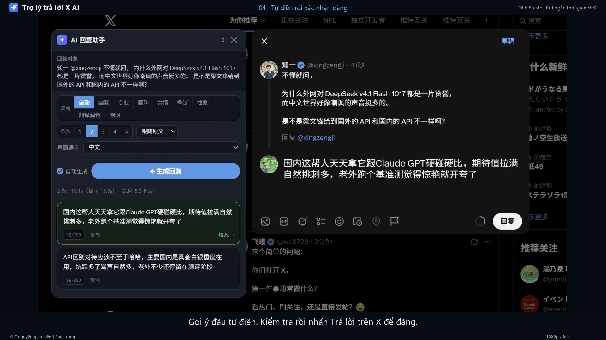
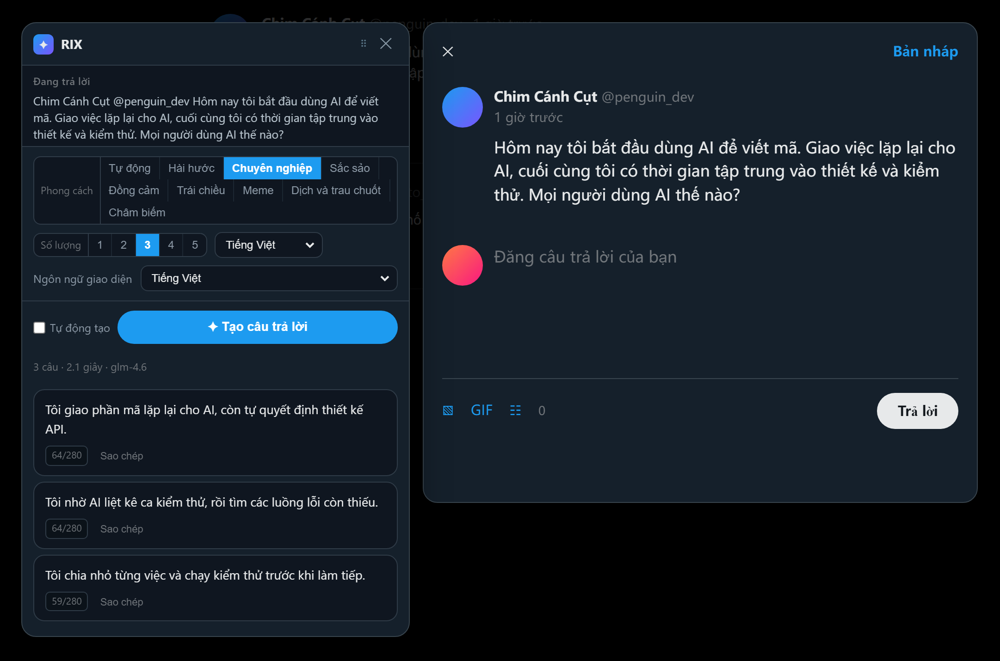
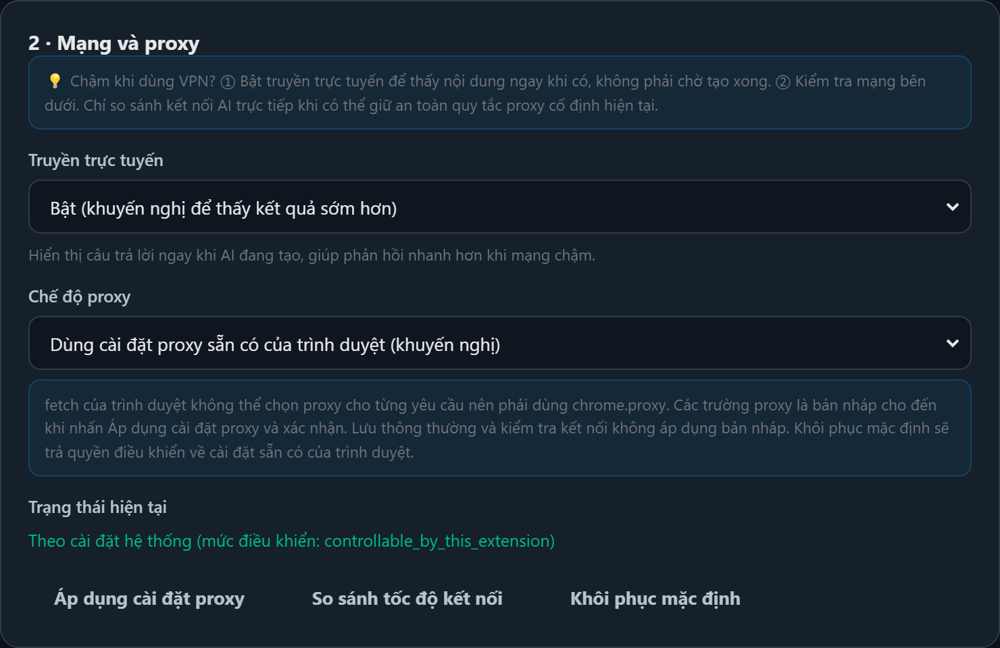
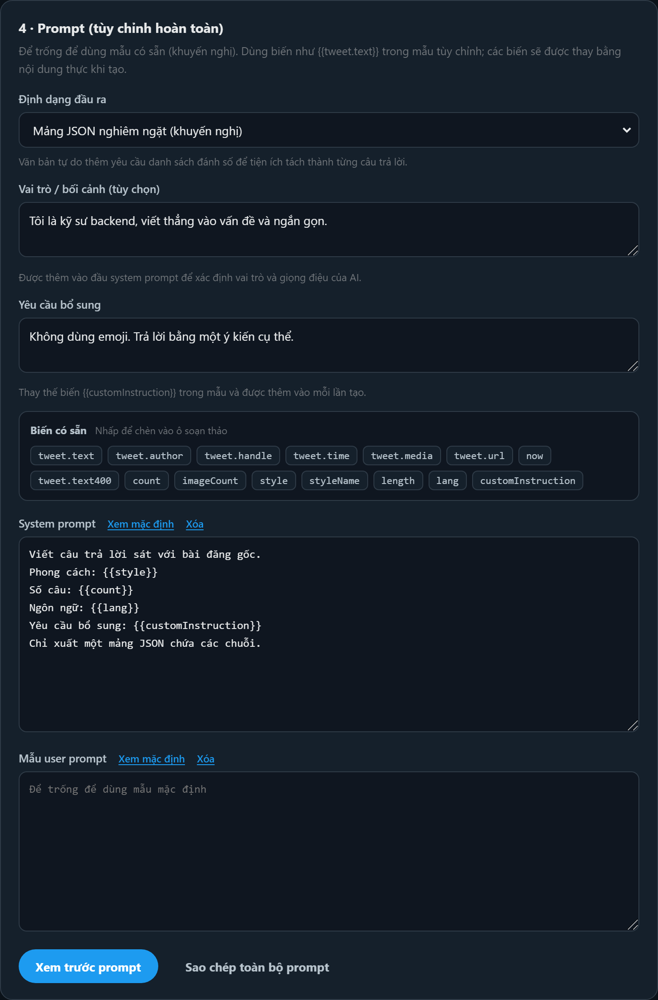

# RIX

[中文](README.md) | [English](README.en.md) | [日本語](README.ja.md) | [Tiếng Việt](README.vi.md) | [한국어](README.ko.md)

Khi bạn nhấp vào **biểu tượng trả lời** của một bài đăng trên dòng thời gian X (Twitter) để mở hộp thoại soạn trả lời, tiện ích sẽ tự động đọc nội dung bài đăng, gọi AI để tạo **nhiều gợi ý trả lời**. Chỉ cần nhấp vào một gợi ý để điền ngay vào ô soạn thảo.

Đây là tiện ích Chrome hoàn toàn phía trình duyệt (Manifest V3), không cần máy chủ riêng. API Key chỉ được lưu cục bộ trong `chrome.storage.local`; trình duyệt gửi yêu cầu trực tiếp đến nhà cung cấp mô hình do bạn chọn.

## ▶ Video demo

[](https://youtu.be/kYoX6VaA7LA)

**[▶ Xem demo tiếng Việt trên YouTube (60 giây · 1080p)](https://youtu.be/kYoX6VaA7LA)**

Thao tác trên X thực tế với thuyết minh và phụ đề tiếng Việt. Nhấp vào ảnh để xem video; giao diện trong bản ghi vẫn là tiếng Trung.

Ngôn ngữ video: [中文](https://youtu.be/dpnf_gy5-6I) | [English](https://youtu.be/Rwp-c2AgEto) | [日本語](https://youtu.be/YlWo3uloYP8) | [Tiếng Việt](https://youtu.be/kYoX6VaA7LA) | [한국어](https://youtu.be/Q62Dzl1gD8s) · [Tệp video và phụ đề](store/real-demos/README.md)

### Xem trước giao diện



Các ảnh chụp bên dưới sử dụng ngôn ngữ giao diện tương ứng với README này; dữ liệu mẫu chỉ dùng để minh họa. Bạn vẫn có thể chuyển giao diện giữa năm ngôn ngữ được liệt kê bên dưới.

---

## Tính năng

| Tính năng | Mô tả |
|---|---|
| Tự nhận diện hộp thoại | Phát hiện hộp thoại trả lời trên X; dùng nhiều bộ chọn dự phòng để thích ứng tốt hơn khi X thay đổi giao diện |
| Trích xuất bài đăng | Lấy tên tác giả, handle, nội dung, thời gian đăng và loại nội dung đa phương tiện; nhận diện được cả bài chỉ có ảnh hoặc video |
| Nhiều gợi ý | Tạo 1–5 câu trả lời mỗi lần, với cách thể hiện khác nhau, thay vì chỉ viết lại cùng một câu |
| **Tùy chỉnh prompt** | **Tùy chỉnh hoàn toàn mẫu system / user, nội suy 15 `{{biến}}` và xem trước ngay** |
| **Truyền trực tuyến** | **Hiển thị từng gợi ý ngay khi gợi ý đó hoàn chỉnh, không cần chờ tạo xong tất cả; tốc độ thực tế phụ thuộc mô hình và mạng** |
| **Kéo thả bảng gợi ý** | Giữ thanh tiêu đề để kéo; vị trí được cố định sau khi thả; nhấp đúp để đặt lại |
| Tự động + 8 phong cách | Tự chọn giọng điệu, hoặc chọn hài hước / chuyên nghiệp / sắc sảo / đồng cảm / trái chiều / Meme / dịch và trau chuốt / châm biếm |
| Điền bằng một lần nhấp | Nhấp gợi ý để điền vào trình soạn thảo Draft.js; **bộ đếm ký tự và nút đăng vẫn cập nhật bình thường** |
| Theo dõi yêu cầu lâu | Hiển thị thời gian đã chạy và độ trễ đến nội dung đầu tiên; có thanh tiến trình sau 30 giây; có thể «Dừng» bất cứ lúc nào |
| Thử lại khi lỗi | Khi xảy ra lỗi, nút chuyển thành «↻ Thử lại» và vẫn dùng được, không bị kẹt ở trạng thái vô hiệu hóa |
| Không che hộp thoại | Ưu tiên đặt bảng gợi ý bên trái hộp thoại để bạn vẫn thấy ô soạn thảo và nút đăng |
| Nhiều nhà cung cấp | Zhipu GLM / DeepSeek / OpenAI / Claude / Kimi / OpenRouter / tùy chỉnh (Ollama, vLLM, v.v.) |
| Giao diện đa ngôn ngữ | 中文 / English / 日本語 / Tiếng Việt / 한국어; theo ngôn ngữ trình duyệt hoặc chọn thủ công |

### Ngôn ngữ giao diện và ngôn ngữ trả lời

Bạn có thể chọn «Ngôn ngữ giao diện» trong bảng trả lời, cửa sổ bật lên của tiện ích và trang toàn bộ cài đặt. Mặc định, tiện ích dùng ngôn ngữ trình duyệt; bạn cũng có thể chọn thủ công tiếng Trung, tiếng Anh, tiếng Nhật, tiếng Việt hoặc tiếng Hàn. Thay đổi có hiệu lực ngay và được lưu cục bộ.

«Ngôn ngữ trả lời» quyết định riêng ngôn ngữ AI dùng để trả lời, hỗ trợ năm ngôn ngữ trên và tùy chọn «Theo bài gốc». Đổi ngôn ngữ giao diện không làm thay đổi ngôn ngữ trả lời, các gợi ý đã tạo, nội dung đang soạn hoặc prompt tùy chỉnh.

### Phím tắt

- `Ctrl / ⌘ + Enter` — Tạo câu trả lời
- `Esc` — Đóng bảng gợi ý
- Mỗi thẻ gợi ý có nút «Sao chép» để sao chép câu trả lời đó

---

## Mạng chậm hoặc chậm khi dùng VPN

Các bước dưới đây được sắp theo mức hiệu quả so với công sức. **Hãy thử bước 1 trước**; trong nhiều trường hợp, như vậy là đủ.

### 1. Giữ «Truyền trực tuyến» ở trạng thái bật (mặc định đã bật)

Khi không dùng truyền trực tuyến, bạn phải chờ mô hình **tạo xong toàn bộ N câu trả lời** mới thấy kết quả. Khi bật, các gợi ý đã nhận đầy đủ có thể hiện ra và được sử dụng trước; những gợi ý còn lại sẽ xuất hiện sau.
Thời gian chờ thực tế phụ thuộc mô hình và mạng. Thanh trạng thái hiển thị thời gian đến nội dung đầu tiên, «x.x s», để bạn theo dõi độ trễ phản hồi.

### 2. So sánh tốc độ trước khi quyết định đổi proxy

Trong trang cài đặt, mở **2 · Mạng và proxy** → nhấp **«So sánh tốc độ kết nối»**. Tiện ích sẽ đo riêng:

| Phép đo | Ý nghĩa |
|---|---|
| Cài đặt mạng hiện tại | Dùng cấu hình mặc định của trình duyệt/hệ thống, bao gồm VPN nếu VPN đang có hiệu lực |
| Kết nối trực tiếp API AI | Bỏ qua proxy và kết nối trực tiếp đến API AI |

Số nhỏ hơn nghĩa là nhanh hơn. Phép đo giữ nguyên máy chủ proxy và định tuyến của các trang khác, chỉ tạm thêm quy tắc bỏ qua proxy cho API AI rồi khôi phục sau khi đo xong.

Chỉ có thể so sánh kết nối trực tiếp một cách an toàn khi trình duyệt đang dùng quy tắc proxy cố định mà tiện ích có thể giữ nguyên. Với proxy hệ thống, PAC hoặc proxy do tiện ích khác điều khiển, chỉ mạng hiện tại được đo; lý do bỏ qua phép so sánh trực tiếp sẽ được hiển thị rõ.



### 3. Chọn chế độ proxy

| Chế độ | Phạm vi ảnh hưởng | Mô tả |
|---|---|---|
| **Theo cài đặt mặc định của hệ thống** | Không thay đổi cài đặt sẵn có | Mặc định. Nếu VPN hoạt động ở cấp hệ thống thì lưu lượng vốn đã đi qua VPN; **đa số người dùng không cần thay đổi** |
| **AI kết nối trực tiếp, các trang khác vẫn qua proxy** | Toàn bộ trình duyệt | Nhập proxy cố định; miền AI bỏ qua proxy, các trang khác dùng proxy này. Có bước xác nhận thay thế quy tắc định tuyến hiện có trước khi áp dụng |
| **Kết nối trực tiếp toàn bộ** | ⚠️ Toàn bộ trình duyệt | Tắt proxy cho **mọi tab**; một số trang khác có thể không truy cập được. Cần xác nhận thêm |

> ⚠️ **Vì sao phải thiết kế như vậy:** `fetch()` của trình duyệt **không thể chỉ định proxy cho từng yêu cầu**; API này không có tùy chọn proxy.
> Muốn chọn proxy, tiện ích phải thay đổi quy tắc **toàn trình duyệt** bằng `chrome.proxy`. Vì vậy, «Kết nối trực tiếp toàn bộ» thực sự ảnh hưởng đến cả trình duyệt.
> Đó là lý do có chế độ «AI kết nối trực tiếp, các trang khác vẫn qua proxy»: chế độ này dùng `bypassList` để chỉ bỏ qua proxy cho các miền AI.
>
> Chế độ `auto` mặc định không tiếp quản proxy trình duyệt và sẽ gỡ cấu hình ghi đè do chính tiện ích đã đặt trước đó. Cả `direct` và `custom` đều yêu cầu xác nhận và nêu rõ phạm vi ảnh hưởng.
> Thay đổi trong biểu mẫu proxy chỉ được lưu sau khi nhấp «Áp dụng cài đặt proxy»; tính năng tự lưu thông thường không kích hoạt bản nháp proxy.
> Nhấp «Khôi phục mặc định», khôi phục toàn bộ cài đặt mặc định hoặc tắt tiện ích trong trang cài đặt sẽ gỡ cấu hình proxy ghi đè của tiện ích và trả lại quyền điều khiển.

---

## Thao tác với bảng gợi ý

- **Kéo:** Giữ thanh tiêu đề có biểu tượng `⠿` để kéo. Sau khi kéo, bảng sẽ **cố định tại vị trí bạn đặt**, không còn tự di chuyển theo hộp thoại.
- **Đặt lại vị trí:** Nhấp đúp thanh tiêu đề hoặc nhấp nút «Đặt lại vị trí» ở bên phải thanh tiêu đề.
- Khi đóng hộp thoại soạn trả lời rồi mở một hộp thoại mới, bảng sẽ lại tự đặt cạnh hộp thoại.

---

## Cài đặt

```
1. Mở chrome://extensions/
2. Bật «Chế độ dành cho nhà phát triển» ở góc trên bên phải
3. Nhấp «Tải tiện ích đã giải nén», chọn thư mục gốc dự án (thư mục chứa manifest.json)
```

Trang cài đặt sẽ tự mở khi cài lần đầu.

### Cấu hình

1. Nhấp biểu tượng tiện ích → «Tất cả cài đặt»
2. Chọn nhà cung cấp trong «Thiết lập nhanh» (ví dụ Zhipu GLM); Base URL và tên mô hình sẽ được điền sẵn
3. Nhập **API Key**
4. Nhấp **«Kiểm tra kết nối»**; nếu nhận được câu trả lời mẫu thì cấu hình đã đúng
5. Đóng trang cài đặt, vào X và nhấp biểu tượng trả lời

> ⚠️ **Đừng đặt `max_tokens` quá thấp.** Các mô hình suy luận (dòng GLM / dòng o / Claude có chế độ suy nghĩ) dùng reasoning tokens trước khi xuất nội dung trả lời.
> Nếu giới hạn quá thấp, có thể xảy ra tình trạng «yêu cầu thành công nhưng nội dung là chuỗi rỗng» **mà không báo lỗi**. Giới hạn dưới 2000 rất dễ gặp tình trạng này; giá trị mặc định của dự án là 4000.

### Nâng cấp tiện ích đã cài

Sau khi sửa mã hoặc tải phiên bản mới, hãy nhấp **nút tải lại** trên thẻ tiện ích trong `chrome://extensions/`, rồi **tải lại trang X**.
Nếu không tải lại, trình duyệt vẫn dùng các script cũ trong bộ nhớ đệm.

---

## Cấu hình prompt

Mục **4 · Prompt** trong trang cài đặt có ba lớp tùy chỉnh. **Để trống để dùng giá trị mặc định tích hợp** (khuyến nghị):

| Lớp | Vai trò |
|---|---|
| **Vai trò / bối cảnh** | Được chèn vào đầu system prompt để xác định lâu dài vai trò và giọng điệu của AI |
| **Yêu cầu bổ sung chung** | Thay thế `{{customInstruction}}` trong mẫu, được gửi trong mỗi lần tạo |
| **Mẫu System / User** | Tùy chỉnh toàn bộ prompt, dùng `{{biến}}` làm chỗ điền |

### Các biến có sẵn (15 biến)

Nhấp vào nhãn biến trong trang cài đặt để chèn tại vị trí con trỏ. Tên biến viết sai sẽ được cảnh báo ngay.

| Biến | Ý nghĩa | Biến | Ý nghĩa |
|---|---|---|---|
| `tweet.text` | Nội dung bài đăng | `count` | Số câu trả lời cần tạo |
| `tweet.author` | Tên hiển thị của tác giả | `style` | Mô tả phong cách, gồm hướng dẫn chi tiết |
| `tweet.handle` | Handle của tác giả | `styleName` | Tên phong cách, ví dụ «Hài hước» |
| `tweet.time` | Thời gian đăng | `length` | Mô tả độ dài |
| `tweet.media` | Loại nội dung đa phương tiện | `lang` | Ngôn ngữ trả lời |
| `tweet.url` | Liên kết bài đăng | `customInstruction` | Yêu cầu bổ sung |
| `tweet.text400` | 400 ký tự đầu của bài đăng, dùng cho phong cách tự động | `now` | Thời gian hiện tại lúc tạo |
| `imageCount` | Số ảnh được gửi đến mô hình | | |

### Định dạng đầu ra

- **Mảng JSON nghiêm ngặt** (mặc định, ổn định nhất) — Tiện ích phân tích bằng cách quét cân bằng dấu ngoặc, với nhiều phương án dự phòng
- **Văn bản tự do** — Mô hình đánh số `1. 2. 3.`, linh hoạt hơn khi tùy chỉnh phong cách

### Ví dụ: chỉ cần thông tin hữu ích, không cần cảm xúc

```text
System:
Bạn là kỹ sư giàu kinh nghiệm trong một cộng đồng công nghệ. Hãy trả lời chuyên nghiệp, chừng mực và có thông tin cụ thể.
Phong cách: {{style}}
Số câu trả lời: {{count}}
Ngôn ngữ: {{lang}}
Không dùng emoji hoặc dấu chấm than.

User:
Dưới đây là một bài đăng:
{{tweet.text}}

Hãy viết {{count}} câu trả lời, mỗi câu phải nêu một quan điểm hoặc sự thật cụ thể.
```

Ví dụ này phù hợp hơn với «Định dạng đầu ra = Văn bản tự do».

### Xem trước trực tiếp

Nhấp «Xem trước prompt» để **kết xuất prompt đầy đủ bằng bài đăng mẫu**, hiển thị riêng system và user, **không dùng hạn mức API**.
Sau khi sửa mẫu, hãy xem trước rồi lưu để biết chính xác nội dung mô hình sẽ nhận.

> Phần xem trước và phần gửi thực tế dùng chung logic trong `src/shared/prompt.js`, nên nội dung hiển thị phản ánh nội dung sẽ gửi.



---

## Cấu trúc thư mục

```text
manifest.json                 Tệp khai báo tiện ích
src/
  shared/
    config.js                 Cấu hình mặc định, thiết lập nhà cung cấp, tự động + 8 phong cách, danh sách biến mẫu
    i18n.js                   Từ điển giao diện 5 ngôn ngữ, nhận diện ngôn ngữ trình duyệt, chuyển ngôn ngữ tức thời
    utils.js                  Phân tích đầu ra mô hình, nhận diện ngôn ngữ, đếm ký tự, thông báo toast
    prompt.js                 ★ Tạo mẫu prompt + nội suy biến (dùng chung cho xem trước và gửi)
    proxy.js                  ★ Tạo và áp dụng chế độ proxy (chỉ dùng trong service worker)
  content/
    detector.js               ★ Nhận diện hộp thoại + trích xuất nội dung bài đăng
    editor.js                 ★ Đọc/ghi trình soạn thảo Draft.js (phần cốt lõi của điền nội dung)
    panel.js                  Giao diện bảng gợi ý AI (kéo thả + hiển thị truyền trực tuyến)
    main.js                   Điểm vào: bắt sự kiện trả lời của X, kiểm tra hộp thoại định kỳ
  background/
    service-worker.js         Trung gian yêu cầu AI + phân tích SSE truyền trực tuyến + hai giao thức
  options/                    Trang cài đặt (gồm trình sửa prompt)
  popup/                      Cửa sổ bật lên trên thanh công cụ (bật/tắt nhanh)
icons/                        Biểu tượng tiện ích
tools/                        Script kiểm thử, kiểm tra tĩnh và xem trước
dev/                          Ảnh chụp xem trước giao diện
```

---

## Các điểm chính trong cách triển khai

### Vì sao gọi AI trong service worker

`fetch` của content script bị giới hạn bởi CSP và chính sách cùng nguồn của trang, nên không thể gọi trực tiếp nhà cung cấp mô hình. Khi chuyển yêu cầu sang background:

- Yêu cầu không chịu CSP của trang X
- API Key không lộ cho JavaScript của trang; content script chạy trong môi trường tách biệt
- Có thể quản lý thống nhất thời gian chờ và hủy yêu cầu bằng `AbortController`

### Vì sao phải điền vào trình soạn thảo theo cách này

Ô soạn bài của X là **contenteditable do React quản lý (Draft.js)**. Gán trực tiếp `el.innerHTML = x` hoặc `el.textContent = x` có thể gây ra tình trạng khó hiểu:

> **Văn bản đã hiện ra nhưng bộ đếm ký tự không thay đổi, nút đăng vẫn bị làm mờ.**

Nguyên nhân là state của React không biết nội dung đã đổi. Cách thực hiện đúng (xem `src/content/editor.js`):

1. Gọi `focus()` cho trình soạn thảo
2. Dùng `Range` chọn toàn bộ nội dung rồi gọi `execCommand('delete')` để xóa, đi qua cơ chế chỉnh sửa gốc của trình duyệt để Draft nhận được thay đổi
3. Thử ghi bằng setter gốc; nếu không hỗ trợ thì ghi DOM đã được escape làm phương án dự phòng
4. Phát sự kiện `input` (`inputType: 'insertText'`) và `change` để Draft cập nhật state
5. Đọc lại nội dung sau khi ghi để kiểm tra; nếu không khớp thì thử lại một lần

### Vì sao phân tích đầu ra mô hình cần bốn lớp dự phòng

Trên thực tế, mô hình hiếm khi chỉ trả đúng một mảng JSON. `utils.parseReplyList` lần lượt thử:

1. Phân tích toàn bộ đầu ra như một mảng JSON
2. Dùng **quét cân bằng dấu ngoặc**, có nhận biết ký tự escape trong chuỗi, để tìm mảng trong văn bản dài
3. Tìm khối mã ` ```json `
4. Dự phòng cuối: tách theo xuống dòng hoặc các mục đánh số `1.` / `-`

> Không được đơn giản lấy từ «dấu `[` đầu tiên đến dấu `]` cuối cùng»: nếu nội dung mô hình chứa câu như «theo tài liệu [1]», phần cắt ra sẽ sai.
> Ngoài ra, **mảng số** như `[1,2,3]` không hợp lệ; chỉ chấp nhận **mảng chuỗi**.

### Cách triển khai truyền trực tuyến

Content script và service worker dùng **kết nối Port duy trì lâu dài** (`chrome.runtime.connect`) thay cho sendMessage:

- SSE hỗ trợ xuống dòng LF, CRLF và CR; giữ bộ đệm giữa các chunk và xử lý ký tự UTF-8 bị chia tách
- `reasoning_content` / `thinking_delta` được thống kê riêng, không trộn vào nội dung trả lời
- Bảng gợi ý dùng `parseCompleteReplyList`: **gợi ý chuỗi JSON đã nhận đầy đủ có thể được nhấp và sử dụng ngay**; câu trả lời chưa hoàn chỉnh không thể nhấp, phần chưa nhận xong hiển thị chỗ giữ chỗ
- Khi đóng bảng hoặc nhấp Dừng, tiện ích chủ động `disconnect`; service worker lập tức `abort` để tránh tiếp tục tiêu tốn token không cần thiết

---

## Phát triển và kiểm thử

```bash
# Kiểm thử đơn vị logic cốt lõi (phân tích/ngôn ngữ/đếm ký tự/XSS/prompt/proxy/hợp đồng mô-đun)
node tools/test-core.js

# Kiểm thử hồi quy logic thực của background, trang cài đặt và bảng gợi ý (mô phỏng mạng và Chrome API)
node tools/test-config-regressions.js
node tools/test-network-regressions.js
node tools/test-settings-regressions.js
node tools/test-content-regressions.js
node tools/test-i18n.js
node tools/test-output-languages.js

# Kiểm thử đầu cuối (Chromium thực + tải tiện ích thực)
# Bao phủ: logic DOM, kéo thả bảng gợi ý, tải trang popup/options không có lỗi
python tools/test-e2e.py

# Kiểm tra lưu giữa các trang, hủy xác nhận, đặt lại và bảng truyền trực tuyến trong hồ sơ trình duyệt mới
# Chặn mọi yêu cầu HTTP bên ngoài, không gọi mô hình thực
python tools/test-extension-regressions.py

# Khớp đối tượng trả lời khi tiện ích dịch thêm bản dịch, và chặn điền khi đổi đối tượng
python tools/test-reply-target-regressions.py

# Kiểm tra chuyển 5 ngôn ngữ, đồng bộ giữa các trang và cấu hình riêng ngôn ngữ trả lời trong trình duyệt thực
python tools/test-i18n-browser.py

# Kiểm tra tĩnh (phát hiện lỗi âm thầm làm mất chức năng; nên chạy trước khi commit)
node tools/check-comments.js   # Chú thích nuốt mã (node --check không phát hiện được)
node tools/check-pages.js      # Trang tiện ích thiếu script cần tải

# Kết xuất ảnh xem trước bảng gợi ý vào dev/
python tools/preview.py

# Kết xuất ảnh xem trước trang cài đặt, gồm trình sửa prompt, vào dev/
python tools/preview-options.py

# Tạo ảnh chụp cho README bằng cả năm ngôn ngữ
python tools/preview-readmes.py

# Tạo lại biểu tượng (chỉ dùng thư viện chuẩn, không cần PIL)
python tools/make_icons.py
```

**Phạm vi kiểm thử:**

- **Kiểm thử đơn vị:** Bốn lớp dự phòng của `parseReplyList`, nhận diện ngôn ngữ, đếm ký tự, nội suy biến mẫu (gồm tên biến tiếng Trung), kiểm tra tên biến, mọi trường hợp `buildPrompt` (mặc định/tùy chỉnh/vai trò/plain/biên), phân tích SSE (gói chưa đủ/dòng lỗi/`[DONE]`/keepalive/tách reasoning), cấu hình proxy, trường hợp biên của `extractHost`, cùng **hợp đồng tính đầy đủ của mô-đun**, khẳng định rõ mọi hàm công khai của từng mô-đun đều tồn tại
- **E2E:** Nhận diện hộp thoại, xác định trạng thái trả lời, trích xuất nội dung/tác giả/thời gian bài đăng, điền trình soạn thảo (tiếng Trung + emoji + nội dung rất dài + ghi đè), xóa nội dung, phân tích nhiều gợi ý, escape XSS, bài chỉ có nội dung đa phương tiện, kéo thả bảng gợi ý bằng sự kiện chuột thực (di chuyển/giữ trong khung nhìn/khóa vị trí/nhấp đúp đặt lại), tải trang popup và options không có lỗi

> **Vì sao cần kiểm tra tĩnh:** Có hai loại lỗi cú pháp hoàn toàn hợp lệ, `node --check` vẫn báo thành công nhưng chức năng không hoạt động khi chạy:
> ① Chú thích khối thiếu `*/`, khiến phần mã phía sau bị nuốt vào chú thích; ② Trang tiện ích không tải một script shared cần thiết.
> Nếu lỗi thứ hai xảy ra trong hàm `async`, nó xuất hiện dưới dạng `Uncaught (in promise)`, trong khi **trang nhìn vẫn có vẻ bình thường**.
> Hai công cụ này được viết riêng để phát hiện các trường hợp đó.

---

## Câu hỏi thường gặp

**Hỏi: Nhấp biểu tượng trả lời nhưng bảng gợi ý không hiện?**
Đáp: ① Kiểm tra biểu tượng tiện ích không bị làm mờ và công tắc trong popup đã bật; ② Tải lại trang X, cần làm một lần sau khi cài hoặc nâng cấp tiện ích; ③ Bật «Nhật ký gỡ lỗi» trong cài đặt rồi xem Console.

**Hỏi: Console báo `Xxx is not a function`?**
Đáp: Thường là do tiện ích chưa được tải lại và trình duyệt vẫn chạy script cũ trong bộ nhớ đệm. Nhấp nút tải lại trên thẻ tiện ích ở `chrome://extensions/`, sau đó tải lại trang X.

**Hỏi: Hộp thoại trả lời đã mở, vì sao vẫn báo «Hãy mở hộp thoại trả lời của bài đăng này trước»?**
Đáp: Ở phiên bản cũ, khi hộp thoại không có liên kết bài đăng, tiện ích so sánh lại toàn bộ nội dung. Nếu tiện ích dịch thêm bản dịch, bài đăng có thể bị nhận nhầm là bài khác. Phiên bản hiện tại ưu tiên đọc ID bài gốc; nếu không có ID, vẫn cho phép điền khi nút DOM chứa nội dung gốc và phần văn bản gốc trong nút đó chưa thay đổi. Nếu nội dung gốc bị thay thế hoặc đối tượng trả lời thay đổi, thao tác vẫn bị chặn. Sau khi cập nhật mã, hãy tải lại tiện ích rồi tải lại trang X.

**Hỏi: Báo «Không tìm thấy hộp thoại soạn bài»?**
Đáp: Bộ chọn có thể không còn phù hợp sau khi X đổi giao diện. Mở Cài đặt → «Bật nhật ký gỡ lỗi» để xem kết quả dò tìm trong Console; có thể bổ sung `data-testid` mới vào `D.SEL` trong `src/content/detector.js`. Các bộ chọn có nhiều phương án dự phòng và khả năng chịu lỗi, nên thông thường không cần sửa.

**Hỏi: Tạo câu trả lời quá chậm?**
Đáp: Trước hết hãy kiểm tra «Truyền trực tuyến» đã bật chưa (mặc định bật). Các gợi ý đã nhận đầy đủ có thể hiện trước; thanh trạng thái cho biết thời gian đến nội dung đầu tiên, «x.x s». Nếu vẫn chậm, dùng **«So sánh tốc độ kết nối»** trong cài đặt để kiểm tra đường mạng. Mô hình suy luận cũng có thể dành thời gian suy nghĩ trước khi xuất nội dung; bạn có thể dùng «Tắt suy nghĩ sâu» nếu nhà cung cấp hỗ trợ, hoặc đổi mô hình theo nhu cầu.

**Hỏi: Có bắt buộc cấu hình proxy trong cài đặt không?**
Đáp: Thường không cần, vì tiện ích mặc định dùng cấu hình mạng sẵn có của trình duyệt. Khi cần điều chỉnh, bạn có thể nhập proxy cố định và chọn **«AI kết nối trực tiếp, các trang khác vẫn qua proxy»**. Chế độ này cho miền AI bỏ qua proxy, còn các trang khác dùng proxy cố định bạn nhập; nó thay thế PAC và quy tắc định tuyến hiện có nên sẽ yêu cầu xác nhận trước khi áp dụng.

**Hỏi: Tiện ích có tự tắt proxy của tôi không?**
Đáp: **Không tự ý tắt.** Trong chế độ mặc định «Theo cài đặt mặc định của hệ thống», tiện ích không tiếp quản cài đặt proxy. Chỉ khi bạn tự chọn «Kết nối trực tiếp toàn bộ» và xác nhận, proxy của cả trình duyệt mới bị tắt; đó là lý do không khuyến nghị chế độ này. Nếu muốn kiểm soát chính xác, hãy dùng «AI kết nối trực tiếp, các trang khác vẫn qua proxy».
Ngoài ra, tắt tiện ích trong cài đặt, chuyển về chế độ mặc định hoặc khôi phục toàn bộ cài đặt mặc định sẽ gỡ cấu hình proxy ghi đè của tiện ích và khôi phục cấu hình sẵn có của trình duyệt.

**Hỏi: Bảng gợi ý che hộp thoại hoặc tôi muốn đặt ở chỗ khác?**
Đáp: Giữ thanh tiêu đề có biểu tượng `⠿` và kéo đến vị trí mong muốn. Sau khi kéo, bảng cố định tại đó và không tự di chuyển theo hộp thoại. Nhấp đúp thanh tiêu đề hoặc nhấp «Đặt lại vị trí» để khôi phục định vị tự động.

**Hỏi: Sau khi tùy chỉnh mẫu, AI không làm theo hoặc không phân tích được nhiều câu trả lời?**
Đáp: ① Giữ «Định dạng đầu ra = Mảng JSON nghiêm ngặt»; ② Kiểm tra mẫu không có chỉ dẫn mâu thuẫn như «chỉ xuất một câu trả lời»; ③ Nhấp «Xem trước prompt» để chắc chắn `{{count}}` đã được thay bằng số câu bạn muốn.

**Hỏi: Điều gì xảy ra nếu viết sai tên biến?**
Đáp: Trang cài đặt sẽ cảnh báo ngay bằng chữ đỏ. Khi tạo, biến chưa được định nghĩa sẽ được thay bằng **chuỗi rỗng**; nội dung nguyên dạng `{{xxx}}` không được gửi cho mô hình.

**Hỏi: Có thể thêm phong cách cá nhân của tài khoản vào không?**
Đáp: Có. Dùng trường «Vai trò / bối cảnh», ví dụ «Tôi là kỹ sư backend, nói thẳng, không thích xã giao, không dùng dấu chấm than». Nội dung đó được chèn vào đầu system prompt trong mỗi lần tạo.

**Hỏi: Gặp lỗi khi dùng Ollama cục bộ?**
Đáp: Đặt Base URL thành `http://localhost:11434/v1`, nhấp «Kiểm tra kết nối» trong cài đặt rồi cho phép truy cập địa chỉ đó. Lần đầu kết nối miền tùy chỉnh cũng cần cấp quyền; chỉ nhập địa chỉ không tự cấp quyền truy cập.

**Hỏi: Có thể dùng mô hình khác không?**
Đáp: Có, miễn là tương thích với `/chat/completions` của OpenAI. Trong cài đặt, chọn «Tùy chỉnh (tương thích OpenAI)» rồi nhập Base URL và tên mô hình.

## 📄 Giấy phép

Dự án này được phát hành theo **PolyForm Noncommercial License 1.0.0** — miễn phí cho mục đích cá nhân, học tập, chỉnh sửa và phân phối. **Cấm sử dụng cho mục đích thương mại**. Xem [LICENSE](LICENSE) để biết điều khoản đầy đủ. Liên hệ [onlyonexhj](https://github.com/onlyonexhj) để cấp phép thương mại.
